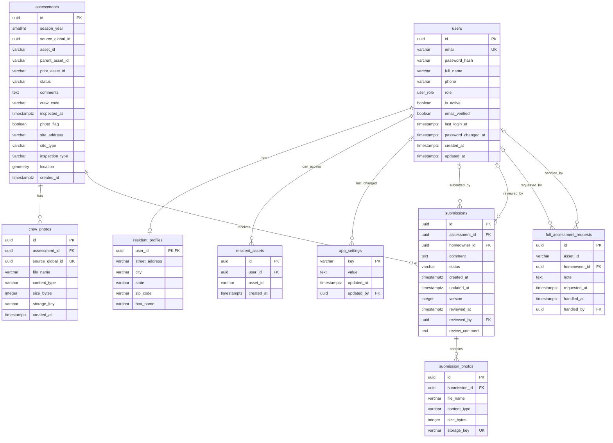

# Database guide

This guide describes the Sprint 5 database through migration `0011`. It covers
the tables, their relationships, setup, imports, and example queries.

The project uses PostgreSQL 16 with PostGIS 3.4, SQLAlchemy 2, and Alembic.
The schema comes from [`backend/migrations/versions`](../backend/migrations/versions).
The matching models are in [`backend/app/models`](../backend/app/models).

## Start from scratch

Run these commands from the repository root with Docker Desktop running. They
use the local defaults below. Change the connection details if your Compose
environment overrides them. These credentials are for local development only.

| Setting | Local default |
| --- | --- |
| Host / port | `localhost` / `5432` |
| Database | `fire_hazard_veg` |
| Test database | `fire_hazard_veg_test` |
| User / password | `fhv` / `fhv_dev_pw` |
| Photo directory inside the API container | `/app/photo_storage` |

1. Put the City-provided `Community_NAOS_Inspections.gdb.zip` file in `data/`,
   or set `NAOS_DATA_DIR` to its containing folder. Do not commit the City data.
2. Start the database and API:

   ```powershell
   docker compose up --build -d db api
   docker compose logs api
   ```

   On the first start, PostgreSQL creates the database and the extensions from
   [`db/init/01_extensions.sql`](../db/init/01_extensions.sql). The API waits
   for the database, runs `alembic upgrade head`, imports the data if present,
   and starts on port 8000. A migration failure stops API startup. An import
   failure is logged, but the API still starts, so check the import counts.
3. Check the migration revision and connect to the database:

   ```powershell
   docker compose exec api python -m alembic current
   docker compose exec db psql -U fhv -d fire_hazard_veg
   ```

   The revision should be `0011`. In `psql`, use `\dt public.*` to list tables,
   `\d+ public.assessments` to inspect a table, and `\q` to exit.

`GET /api/v1/health/db` checks database connectivity and PostGIS. With no data
file, migrations still run and the API starts with no inspection records.

### Run migrations without the API container

For local Python development, use Python 3.11+ and `uv`. From the repo root:

```powershell
docker compose up -d db
cd backend
Copy-Item .env.example .env
uv sync --extra dev
uv run alembic upgrade head
uv run alembic current
```

Copy `.env.example` only when setting up a new checkout; keep existing settings
if `.env` already exists. The default `DATABASE_URL` connects to the local
database above. `TEST_DATABASE_URL` points to `fire_hazard_veg_test`.

### Stored data and reset

Compose stores the database in its `pgdata` volume and image files in its
`photos` volume. `docker compose down` keeps both. **`docker compose down -v`
deletes both the database and the stored photos.** Back up both volumes before
removing them. Re-importing restores crew data from the City file, but does not
restore accounts, homeowner uploads, reviews, settings, or assessment requests.

## Schema overview

There are nine application tables in the `public` schema:

| Table | Purpose |
| --- | --- |
| `users` | Login accounts for residents and administrators |
| `resident_profiles` | Address details retained for older accounts |
| `resident_assets` | Properties a resident is allowed to view |
| `assessments` | Original inspection points imported from the City |
| `crew_photos` | Metadata for the original inspection photos |
| `app_settings` | Administrator-edited portal messages |
| `submissions` | Homeowner evidence and the department's review |
| `submission_photos` | Metadata for homeowner evidence photos |
| `full_assessment_requests` | Requests for a full property assessment |

`alembic_version` and PostGIS's `spatial_ref_sys` also appear in `public`.
Their fields are listed separately below. `geometry_columns` and
`geography_columns` are PostGIS views. An installation may also contain the
extension-managed `tiger`, `tiger_data`, and `topology` schemas; these are not
portal tables.

### Relationships

The diagram shows the nine application tables and their foreign keys. `o|`
means the parent link is optional; `o{` means zero or more child records.



For `users.email`, UK means the unique index on `lower(email)`, not a normal
case-sensitive unique constraint. Composite keys and other indexes are detailed
below. The diagram uses zero-or-more photos per submission because that is what
the database enforces; the upload API requires one to five.

`asset_id` is an external property identifier. Many inspection points and seasons
can share it. `resident_assets.asset_id`, `full_assessment_requests.asset_id`,
`parent_asset_id`, and `prior_asset_id` are not foreign keys to one assessment
row. The application verifies resident links against imported assessments.

## Table and field reference

`Nullable: Yes` means the column accepts SQL `NULL`. A default of `none` means
the database has no default expression; an omitted nullable value becomes
`NULL`. `timestamptz` means `timestamp with time zone`. UUID defaults use
`gen_random_uuid()`; timestamps with `now()` are set when the row is inserted.
Every primary key creates a unique B-tree index. Additional indexes below are
B-tree unless marked GiST. Foreign keys do not automatically create indexes.

### `users`

The shared account table. The `user_role` enum contains `resident` and `admin`.
Migration `0006` removed the firefighter role and `firefighter_profiles` table;
field crews continue using ArcGIS and Survey123.

| Column | Type | Nullable | Database default | Meaning |
| --- | --- | --- | --- | --- |
| `id` | `uuid` | No | `gen_random_uuid()` | Primary key |
| `email` | `varchar(255)` | No | none | Login email; unique ignoring case |
| `password_hash` | `varchar(255)` | No | none | Password hash, never a plain password |
| `full_name` | `varchar(120)` | No | none | Display name |
| `phone` | `varchar(20)` | Yes | none | Optional phone number |
| `role` | `user_role` | No | `'resident'` | Account role |
| `is_active` | `boolean` | No | `true` | Whether the account can sign in |
| `email_verified` | `boolean` | No | `false` | Email verification flag |
| `last_login_at` | `timestamptz` | Yes | none | Last successful sign-in |
| `password_changed_at` | `timestamptz` | Yes | none | Used to reject older session tokens |
| `created_at` | `timestamptz` | No | `now()` | Account creation time |
| `updated_at` | `timestamptz` | No | `now()` | Last account update through the ORM |

Keys and indexes: `pk_users`; unique `uq_users_email_lower` on `lower(email)`;
`ix_users_role` on `role`. SQLAlchemy updates `updated_at` on account writes;
there is no database trigger that updates it for direct SQL.

Deleting a user cascades to their profile and property links. Evidence,
requests, and edited messages remain, with the corresponding user references
set to `NULL`. Deactivation sets `is_active = false` and does not delete rows.

### `resident_profiles`

Legacy address information. Current sign-up creates an account without this
profile; property access is recorded in `resident_assets`.

| Column | Type | Nullable | Database default | Meaning |
| --- | --- | --- | --- | --- |
| `user_id` | `uuid` | No | none | Primary key and FK to `users.id` |
| `street_address` | `varchar(255)` | No | none | Address entered for an older account |
| `city` | `varchar(80)` | No | `'Scottsdale'` | City |
| `state` | `varchar(2)` | No | `'AZ'` | State abbreviation |
| `zip_code` | `varchar(10)` | Yes | none | ZIP code; nullable since `0004` |
| `hoa_name` | `varchar(120)` | Yes | none | Optional HOA name |

Keys and indexes: `pk_resident_profiles` on `user_id`; no extra indexes.
`fk_resident_profiles_user_id_users` uses `ON DELETE CASCADE`.

### `resident_assets`

Links a resident account to each property it can open. One resident can have
several links, and different residents can be linked to the same property.

| Column | Type | Nullable | Database default | Meaning |
| --- | --- | --- | --- | --- |
| `id` | `uuid` | No | `gen_random_uuid()` | Primary key |
| `user_id` | `uuid` | No | none | FK to `users.id` |
| `asset_id` | `varchar(32)` | No | none | Verified external property ID |
| `created_at` | `timestamptz` | No | `now()` | Link creation time |

Keys and indexes: `pk_resident_assets`; unique constraint
`uq_resident_assets_user_asset` on `(user_id, asset_id)`;
`ix_resident_assets_user_id`; `ix_resident_assets_asset_id`.
`fk_resident_assets_user_id_users` uses `ON DELETE CASCADE`.
Removing a link does not remove inspection records, requests, or photos.

### `assessments`

One row per inspected point from the City's seasonal file. The import matches
points using `(season_year, source_global_id)`, not `asset_id`.

| Column | Type | Nullable | Database default | Meaning |
| --- | --- | --- | --- | --- |
| `id` | `uuid` | No | `gen_random_uuid()` | Primary key |
| `season_year` | `smallint` | No | none | Inspection season |
| `source_global_id` | `uuid` | No | none | City's GlobalID for the point |
| `asset_id` | `varchar(32)` | No | none | External property ID; may repeat |
| `parent_asset_id` | `varchar(32)` | Yes | none | Parent ID supplied by the City |
| `prior_asset_id` | `varchar(32)` | Yes | none | Prior-year ID supplied by the City |
| `status` | `varchar(40)` | No | none | Original crew result: `ISSUES` or `NO ISSUES` |
| `comments` | `text` | Yes | none | Crew comments |
| `crew_code` | `varchar(16)` | Yes | none | Crew identifier |
| `inspected_at` | `timestamptz` | Yes | none | Inspection time from the source |
| `photo_flag` | `boolean` | Yes | none | Crew's original photo flag |
| `site_address` | `varchar(255)` | Yes | none | Imported address |
| `site_type` | `varchar(80)` | Yes | none | Imported site type |
| `inspection_type` | `varchar(80)` | Yes | none | Imported inspection type |
| `location` | `geometry(Point,4326)` | Yes | none | WGS84 longitude/latitude point |
| `created_at` | `timestamptz` | No | `now()` | Import insertion time |

Keys and indexes: `pk_assessments`; unique constraint
`uq_assessments_season_global_id` on `(season_year, source_global_id)`;
`ix_assessments_asset_id`; `ix_assessments_status`; `ix_assessments_crew_code`;
GiST `ix_assessments_location` on `location`.

`status` has no database check constraint. Its values are the imported result,
not the portal's review state. Count real `crew_photos` rows when checking for
photos; `photo_flag` is kept as supplied and may not match the saved files.
Deleting an assessment cascades to its crew-photo metadata, submissions, and
submission-photo metadata. It does not automatically delete the files.

### `crew_photos`

Metadata for photos taken by the crew. Image bytes are stored outside PostgreSQL.

| Column | Type | Nullable | Database default | Meaning |
| --- | --- | --- | --- | --- |
| `id` | `uuid` | No | `gen_random_uuid()` | Primary key |
| `assessment_id` | `uuid` | No | none | FK to `assessments.id` |
| `source_global_id` | `uuid` | No | none | City's attachment GlobalID |
| `file_name` | `varchar(255)` | No | none | Original display filename |
| `content_type` | `varchar(50)` | No | none | MIME type |
| `size_bytes` | `integer` | No | none | File size in bytes |
| `storage_key` | `varchar(255)` | No | none | Private photo-store path |
| `created_at` | `timestamptz` | No | `now()` | Import insertion time |

Keys and indexes: `pk_crew_photos`; unique constraint
`uq_crew_photos_source_global_id`; `ix_crew_photos_assessment_id`.
`fk_crew_photos_assessment_id_assessments` uses `ON DELETE CASCADE`.
Unlike homeowner photos, this table has no unique constraint on `storage_key`
and no positive-size check.

### `app_settings`

Stores administrator-edited portal messages. If a key has no row, the default
from [`editable_messages.py`](../backend/app/services/editable_messages.py)
applies. Resetting a message deletes its row. Unknown keys are ignored by the
registry; there is no separate message history.

| Column | Type | Nullable | Database default | Meaning |
| --- | --- | --- | --- | --- |
| `key` | `varchar(64)` | No | none | Primary key; message registry key |
| `value` | `text` | No | none | Saved message text |
| `updated_at` | `timestamptz` | No | `now()` | Last saved time; service sets it on edits |
| `updated_by` | `uuid` | Yes | none | FK to `users.id`; last editing admin |

Keys and indexes: `pk_app_settings` on `key`; no extra indexes.
`fk_app_settings_updated_by_users` uses `ON DELETE SET NULL`.

### `submissions`

Homeowner completion evidence for an inspection point. A pending submission
can be edited in place. Department review updates the same row. Submitting new
evidence after rejection creates another row and keeps the earlier submission.

| Column | Type | Nullable | Database default | Meaning |
| --- | --- | --- | --- | --- |
| `id` | `uuid` | No | `gen_random_uuid()` | Primary key |
| `assessment_id` | `uuid` | No | none | FK to `assessments.id` |
| `homeowner_id` | `uuid` | Yes | none | FK to `users.id`; submitting resident |
| `comment` | `text` | Yes | none | Homeowner's optional comment |
| `status` | `varchar(24)` | No | `'pending_review'` | `pending_review`, `approved`, or `rejected` |
| `created_at` | `timestamptz` | No | `now()` | Initial submission time |
| `updated_at` | `timestamptz` | Yes | none | Pending-evidence edit time |
| `version` | `integer` | No | `1` | Increased by the service on edits and reviews |
| `reviewed_at` | `timestamptz` | Yes | none | Department decision time |
| `reviewed_by` | `uuid` | Yes | none | FK to `users.id`; reviewing admin |
| `review_comment` | `text` | Yes | none | Department comment; send-back reason |

Keys and indexes: `pk_submissions`; `ix_submissions_assessment_id`;
`ix_submissions_homeowner_id`. Check constraint `ck_submissions_status` restricts
`status` to the three values above. `fk_submissions_assessment_id_assessments`
uses `ON DELETE CASCADE`. `fk_submissions_homeowner_id_users` and
`fk_submissions_reviewed_by_users` use `ON DELETE SET NULL`.

The API requires an open issue in the property's latest season and prevents
duplicate pending evidence. Those rules, photo-count limits, review permissions,
and version checks live in the services; they are not extra table constraints.
Reviewed evidence is read-only through the API.

### `submission_photos`

Metadata for private homeowner photos. This table has no `created_at` column;
use the parent submission's timestamps.

| Column | Type | Nullable | Database default | Meaning |
| --- | --- | --- | --- | --- |
| `id` | `uuid` | No | `gen_random_uuid()` | Primary key |
| `submission_id` | `uuid` | No | none | FK to `submissions.id` |
| `file_name` | `varchar(255)` | No | none | Original display filename |
| `content_type` | `varchar(50)` | No | none | MIME type; API accepts JPEG or PNG |
| `size_bytes` | `integer` | No | none | File size in bytes |
| `storage_key` | `varchar(255)` | No | none | Unique private photo-store path |

Keys and indexes: `pk_submission_photos`; unique constraint
`uq_submission_photos_storage_key`; `ix_submission_photos_submission_id`.
Check constraint `ck_submission_photos_positive_size` requires `size_bytes > 0`.
`fk_submission_photos_submission_id_submissions` uses `ON DELETE CASCADE`.
Deleting metadata does not itself remove the corresponding files.

### `full_assessment_requests`

A homeowner's request for a full assessment of one property. Requests remain
separate from individual inspection points and photo submissions.

| Column | Type | Nullable | Database default | Meaning |
| --- | --- | --- | --- | --- |
| `id` | `uuid` | No | `gen_random_uuid()` | Primary key |
| `asset_id` | `varchar(32)` | No | none | External property ID; not an assessment FK |
| `homeowner_id` | `uuid` | Yes | none | FK to `users.id`; requesting resident |
| `note` | `text` | Yes | none | Optional homeowner note |
| `requested_at` | `timestamptz` | No | `now()` | Request creation time |
| `handled_at` | `timestamptz` | Yes | none | When an administrator marked it handled |
| `handled_by` | `uuid` | Yes | none | FK to `users.id`; handling administrator |

Keys and indexes: `pk_full_assessment_requests`;
`ix_full_assessment_requests_asset_id`;
`ix_full_assessment_requests_homeowner_id`;
`ix_full_assessment_requests_requested_at`;
`ix_full_assessment_requests_handled_at`.
Unique partial index `uq_full_assessment_requests_open_asset` covers
`lower(asset_id)` **where `handled_at IS NULL`**. It allows only one open request
per property, even across different homeowners, while retaining handled requests.
`fk_full_assessment_requests_homeowner_id_users` and
`fk_full_assessment_requests_handled_by_users` use `ON DELETE SET NULL`.

There is no stored `status` column. A request is `open` when `handled_at` is
`NULL`, otherwise `handled`. A handled request no longer blocks a new one.
Requests have no season column and are not automatically removed during import.

### Managed tables

These tables support migrations and spatial data. Application code does not
create user records in them.

#### `alembic_version`

| Column | Type | Nullable | Database default | Meaning |
| --- | --- | --- | --- | --- |
| `version_num` | `varchar(32)` | No | none | Current Alembic revision; primary key |

Key: `alembic_version_pkc`. At this guide's revision it contains `0011`. Alembic
manages this table; do not change the revision manually to skip migrations.

#### `spatial_ref_sys`

| Column | Type | Nullable | Database default | Meaning |
| --- | --- | --- | --- | --- |
| `srid` | `integer` | No | none | Spatial reference identifier; primary key |
| `auth_name` | `varchar(256)` | Yes | none | Naming authority, such as EPSG |
| `auth_srid` | `integer` | Yes | none | Authority's reference number |
| `srtext` | `varchar(2048)` | Yes | none | Coordinate system definition |
| `proj4text` | `varchar(2048)` | Yes | none | Projection definition |

Key: `spatial_ref_sys_pkey`. Check `spatial_ref_sys_srid_check` requires
`srid > 0 AND srid <= 998999`. It has no application foreign keys. PostGIS
manages its reference rows; the portal uses SRID 4326.

## Review state and photo storage

The original `assessments.status` does not change when a homeowner submits work
or an administrator reviews it. For an `ISSUES` point, the portal uses its
latest submission, ordered by `created_at DESC, id ASC`:

| Latest submission | Issue review state |
| --- | --- |
| No submission | `open` |
| `pending_review` | `pending_review` |
| `approved` | `closed` |
| `rejected` | `open` |

Across a property's issue points, any pending submission makes the property
`pending_review`. It is `closed` only when every issue point's latest evidence
is approved, and `open` otherwise. A property with no issue points has no issue
review state. See [`review_state.py`](../backend/app/services/review_state.py).

There is no separate status-change table. Submission history contains the
saved submission records, their edit times, and their final review details.
Pending edits and review decisions update a row in place, so this is not a
complete log of every earlier field value or state transition.

The photo tables contain metadata, not image bytes. `storage_key` is relative
to `PHOTO_STORAGE_DIR`. Docker uses the `photos` volume at `/app/photo_storage`:

- Crew files: `crew/<assessment UUID>/<photo UUID>.jpg|png`.
- Homeowner files: `homeowner/<assessment UUID>/<submission UUID>/<photo UUID>.jpg|png`.

Crew and homeowner photos use protected API routes. Storage keys are not public
URLs and are not returned by the API. Back up the database and photo files
together. Foreign-key cascades delete metadata only; operational deletion also
needs file cleanup. See [homeowner photo storage](homeowner-photo-upload.md).

## Migrations

The current chain is linear: `0001` through `0011`, with one head at `0011`.

| Revision | File in `backend/migrations/versions/` | Change |
| --- | --- | --- |
| `0001` | `20261007_0001_enable_extensions.py` | Enable `postgis` and `pgcrypto` |
| `0002` | `20261007_0002_add_users_and_role_profiles.py` | Add users, resident profiles, and the former firefighter profiles |
| `0003` | `20261015_0003_add_assessments_and_crew_photos.py` | Add original inspection points and crew-photo metadata |
| `0004` | `20261015_0004_link_residents_to_assets.py` | Add resident property links; allow a null resident ZIP |
| `0005` | `20261027_0005_add_password_changed_at.py` | Track password changes for session invalidation |
| `0006` | `20261103_0006_remove_firefighter_role.py` | Remove firefighter profiles and replace the role enum with resident/admin |
| `0007` | `20261103_0007_add_app_settings.py` | Add saved editable messages; inserts no rows |
| `0008` | `20261104_0008_add_homeowner_submissions.py` | Add homeowner evidence and photo metadata |
| `0009` | `20261104_0009_add_submission_updated_at.py` | Record pending-evidence edit time |
| `0010` | `20261104_0010_add_submission_review.py` | Add evidence version, reviewer, decision time, and department comment |
| `0011` | `20261104_0011_add_full_assessment_requests.py` | Add full-assessment requests and the one-open-request-per-property index |

When upgrading an older database, `0006` stops if any firefighter accounts
remain. Resolve those accounts deliberately before retrying; the migration
does not choose a replacement role for them.

For a schema change, add a new migration from `backend/`:

```powershell
uv run alembic revision --autogenerate -m "describe the change"
```

Review generated operations before applying them, especially around PostGIS
objects. Updating this guide alone does not require a migration.

## Importing NAOS inspections

The importer accepts a `.gdb.zip` file or an unzipped `.gdb` directory. It loads
points and crew photos from the City's seasonal file. Staff email fields
(`sfd_edit_by`) are not read or stored. Blank comments and addresses become
`NULL`.

With the API container running and the file mounted in `/data`:

```powershell
docker compose exec api python -m app.cli.import_naos /data/Community_NAOS_Inspections.gdb.zip --year 2026 --dry-run
docker compose exec api python -m app.cli.import_naos /data/Community_NAOS_Inspections.gdb.zip --year 2026
```

With a local Python environment, from `backend/`:

```powershell
uv run python -m app.cli.import_naos ../data/Community_NAOS_Inspections.gdb.zip --year 2026 --dry-run
uv run python -m app.cli.import_naos ../data/Community_NAOS_Inspections.gdb.zip --year 2026
```

The supplied 2026 sample has 7,040 points (145 `ISSUES`, 6,895 `NO ISSUES`) and
136 crew photos. Importing it into an empty application database gives:

```text
points: read 7040, inserted 7040, skipped 0
photos: read 136, inserted 136, skipped 0, orphaned 0
```

Running the same import again adds no rows or photos:

```text
points: read 7040, inserted 0, skipped 7040
photos: read 136, inserted 0, skipped 136, orphaned 0
```

Points with an existing `(season_year, source_global_id)` are skipped, not
updated. Crew photos with an existing `source_global_id` are also skipped.
An attachment with no matching point is counted as orphaned and is not saved.
Re-importing does not remove or reset homeowner evidence or review decisions.

At API startup, the entrypoint selects the first sorted `.gdb.zip` or `.gdb`
entry in `/data` when automatic import is enabled. Keep only the intended
source there, or use the explicit CLI command to select a file.

| Variable | Default | Use |
| --- | --- | --- |
| `NAOS_DATA_DIR` | `./data` on the host | Source folder mounted read-only at `/data` by Compose |
| `NAOS_SEASON_YEAR` | `2026` | Season used by automatic import |
| `AUTO_IMPORT` | `true` | Set `false` to skip automatic import; migrations still run |
| `PHOTO_STORAGE_DIR` | `/app/photo_storage` in Docker; `./photo_storage` locally | Root for stored image files |

## Example queries

These are read-only maintenance examples for a developer with database access.
They do not apply the portal's permission checks; residents access data through
the authenticated API. Run them in `psql` after connecting as shown above.

For queries using a property or inspection ID, set these `psql` variables to
real values. Query 1 finds counts; query 2 returns inspection IDs for the chosen
property. The all-zero UUID is a valid placeholder that matches no inspection.

```psql
\set asset_id 'REPLACE_WITH_ASSET_ID'
\set assessment_id '00000000-0000-0000-0000-000000000000'
```

### 1. How many original points and photos were imported for 2026?

```sql
SELECT count(*) AS points,
       count(*) FILTER (WHERE status = 'ISSUES') AS issues,
       count(*) FILTER (WHERE status = 'NO ISSUES') AS no_issues,
       (SELECT count(*) FROM crew_photos p
        JOIN assessments a ON a.id = p.assessment_id
        WHERE a.season_year = 2026) AS crew_photos
FROM assessments
WHERE season_year = 2026;
```

For the supplied sample, expect `7040`, `145`, `6895`, and `136`. These are
point counts, not counts of distinct properties, and may change with a new file.

### 2. What issues were recorded for one property in its latest season?

```sql
SELECT id, asset_id, season_year, inspected_at, status, comments
FROM assessments
WHERE lower(asset_id) = lower(:'asset_id')
  AND season_year = (
      SELECT max(season_year) FROM assessments
      WHERE lower(asset_id) = lower(:'asset_id')
  )
  AND status = 'ISSUES'
ORDER BY inspected_at DESC NULLS LAST, id;
```

### 3. How many crew photos belong to each inspection of that property?

```sql
SELECT a.id, a.season_year, a.status, count(p.id) AS photo_count
FROM assessments a
LEFT JOIN crew_photos p ON p.assessment_id = a.id
WHERE lower(a.asset_id) = lower(:'asset_id')
GROUP BY a.id, a.season_year, a.status
ORDER BY a.season_year DESC, a.id;
```

### 4. Which latest submissions are waiting in the review inbox?

```sql
WITH latest AS (
    SELECT DISTINCT ON (assessment_id) *
    FROM submissions
    ORDER BY assessment_id, created_at DESC, id ASC
)
SELECT s.id, a.asset_id, u.full_name AS homeowner_name,
       s.created_at, s.updated_at, s.comment
FROM latest s
JOIN assessments a ON a.id = s.assessment_id
LEFT JOIN users u ON u.id = s.homeowner_id
WHERE s.status = 'pending_review'
  AND a.status = 'ISSUES'
  AND a.season_year = (
      SELECT max(a2.season_year) FROM assessments a2
      WHERE lower(a2.asset_id) = lower(a.asset_id)
  )
ORDER BY s.created_at, s.id;
```

### 5. What submission and review history is saved for one issue?

```sql
SELECT s.id, s.created_at, s.updated_at, s.status, s.comment,
       s.version, s.reviewed_at, reviewer.full_name AS reviewed_by,
       s.review_comment
FROM submissions s
LEFT JOIN users reviewer ON reviewer.id = s.reviewed_by
WHERE s.assessment_id = :'assessment_id'::uuid
ORDER BY s.created_at, s.id;
```

This returns stored submissions, not every earlier edit or state transition.

### 6. How many accounts exist for each role, including active accounts?

```sql
SELECT roles.role, count(u.id) AS total,
       count(u.id) FILTER (WHERE u.is_active) AS active
FROM unnest(enum_range(NULL::user_role)) AS roles(role)
LEFT JOIN users u ON u.role = roles.role
GROUP BY roles.role
ORDER BY roles.role;
```

### 7. Which full-assessment requests are still open?

```sql
SELECT r.id, r.asset_id, u.full_name AS homeowner_name,
       r.requested_at, r.note
FROM full_assessment_requests r
LEFT JOIN users u ON u.id = r.homeowner_id
WHERE r.handled_at IS NULL
ORDER BY r.requested_at, r.id;
```

### 8. What is the current issue review state of each property?

```sql
WITH latest AS (
    SELECT DISTINCT ON (assessment_id) assessment_id, status
    FROM submissions
    ORDER BY assessment_id, created_at DESC, id ASC
), issue_states AS (
    SELECT lower(a.asset_id) AS asset_key, a.asset_id, s.status
    FROM assessments a
    LEFT JOIN latest s ON s.assessment_id = a.id
    WHERE a.status = 'ISSUES'
      AND a.season_year = (
          SELECT max(a2.season_year) FROM assessments a2
          WHERE lower(a2.asset_id) = lower(a.asset_id)
      )
)
SELECT min(asset_id) AS asset_id,
       CASE
           WHEN bool_or(status = 'pending_review') THEN 'pending_review'
           WHEN bool_and(coalesce(status = 'approved', false)) THEN 'closed'
           ELSE 'open'
       END AS review_state
FROM issue_states
GROUP BY asset_key
ORDER BY asset_id;
```

This uses each property's latest season and leaves out properties with no issue
points. The admin map applies the same state rules within the latest season in
the whole imported dataset.

## Verify the guide against a fresh database

Use a separate database for this check so existing local accounts and uploads
stay intact. With the normal Compose database and a built API image available,
run from the repo root:

```powershell
docker compose exec db psql -U fhv -d postgres -v ON_ERROR_STOP=1 -c "CREATE DATABASE fire_hazard_veg_guide_check TEMPLATE template0;"
docker compose run --rm --no-deps -e DATABASE_URL=postgresql+psycopg://fhv:fhv_dev_pw@db:5432/fire_hazard_veg_guide_check --entrypoint python api -m alembic upgrade head
docker compose exec db psql -U fhv -d fire_hazard_veg_guide_check
```

Use an unused database name; if it already exists, investigate it rather than
overwriting it. In that `psql` session, inspect:

```psql
SELECT version_num FROM alembic_version;
SELECT table_name FROM information_schema.tables
WHERE table_schema = 'public' AND table_type = 'BASE TABLE'
ORDER BY table_name;
\d+ public.users
\d+ public.assessments
\d+ public.submissions
\d+ public.submission_photos
\d+ public.full_assessment_requests
```

Expect revision `0011`, the nine application tables listed above, plus
`alembic_version` and `spatial_ref_sys`. Compare every table's columns, defaults,
constraints, and indexes with the reference; `\d+ public.<table_name>` also
shows foreign-key deletion rules. To list tables in every schema, including
extension-managed schemas outside `public`, use `\dt *.*`.

Import into that separate database using the same connection override:

```powershell
docker compose run --rm --no-deps -e DATABASE_URL=postgresql+psycopg://fhv:fhv_dev_pw@db:5432/fire_hazard_veg_guide_check -e PHOTO_STORAGE_DIR=/tmp/guide-check-photos --entrypoint python api -m app.cli.import_naos /data/Community_NAOS_Inspections.gdb.zip --year 2026
```

The temporary photo directory is removed with that one-off container. This is
only for checking schema, import counts, and queries, not a usable portal
database or a file-storage check. Use a separate persistent photo volume if
testing photo access. Run the eight example queries in the check database.
User/evidence/request queries can be empty until test records are created.

To remove only this check database after exiting `psql` and stopping any client
using it:

```powershell
docker compose exec db psql -U fhv -d postgres -v ON_ERROR_STOP=1 -c "DROP DATABASE fire_hazard_veg_guide_check;"
```
