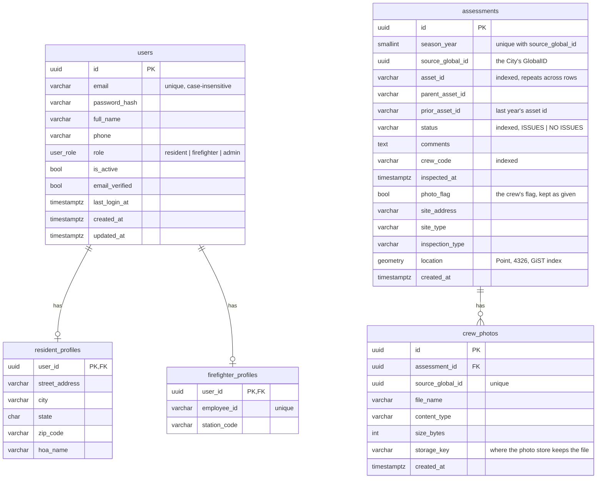

# Database

PostgreSQL 16 with PostGIS 3.4, accessed through SQLAlchemy 2 and migrated with Alembic.

## Local setup

```bash
docker compose up -d db          # from repo root
cd backend
cp .env.example .env
uv sync --extra dev
uv run alembic upgrade head
uv run pytest                    # db tests skip if postgres is down
```

| Setting | Value |
| --- | --- |
| host / port | localhost / 5432 |
| database | `fire_hazard_veg` (tests: `fire_hazard_veg_test`) |
| user / password | `fhv` / `fhv_dev_pw` (local only) |

Health check: `GET /api/v1/health/db`

Reset: `docker compose down -v && docker compose up -d db`

## Schema



Profiles are deleted with their user. Admins have no profile.

`assessments` holds one row per inspected point from the City's yearly file. The same
`asset_id` shows up many times, so it is never a key; a row is identified by
`season_year` plus `source_global_id`. Photos are deleted with their assessment. The
picture itself is not in the database: `storage_key` points to a file in the photo store
(`PHOTO_STORAGE_DIR`, local disk for now). Staff emails (`sfd_edit_by`) are never read
or stored.

## Migrations

| Revision | Change |
| --- | --- |
| `0001` | enable `postgis`, `pgcrypto` |
| `0002` | `users`, `resident_profiles`, `firefighter_profiles` |
| `0003` | `assessments`, `crew_photos` |

New migration: `uv run alembic revision --autogenerate -m "message"`

## Importing NAOS inspections

Loads the City's yearly geodatabase (a `.gdb.zip` file or an unzipped `.gdb` folder). The
sample file is not in this repository; keep your copy outside it.

```bash
cd backend
uv run python -m app.cli.import_naos <path> --year 2026 --dry-run   # read and count only
uv run python -m app.cli.import_naos <path> --year 2026             # write to the database
```

Running it again with the same file adds nothing: points are matched on season plus
GlobalID and photos on their own GlobalID. The output looks like:

```text
points: read 7040, inserted 7040, skipped 0
photos: read 136, inserted 136, skipped 0, orphaned 0
```

A photo whose point is missing is counted as orphaned, not saved, and gets a `warning:`
line. Photos are written under `PHOTO_STORAGE_DIR` as `crew/<assessment id>/<photo id>.jpg`.

To run the test that uses the real file, point `NAOS_GDB_PATH` at it:

```bash
NAOS_GDB_PATH=/path/to/Community_NAOS_Inspections.gdb.zip uv run pytest
```
