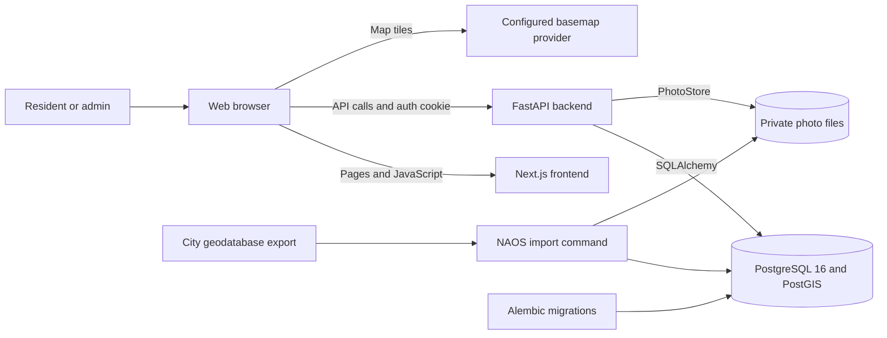
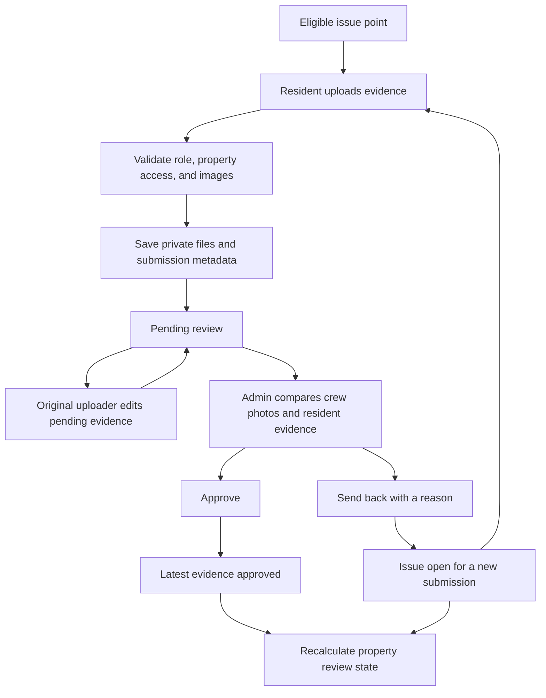

# Theory of operations

Updated November 19, 2026 · User story #48 · Task #84

## 1 Purpose and scope

The Fire Hazardous Vegetation Portal connects the City's inspection records with
resident follow-up and department review. This document explains how its parts
work together, where information is stored, and how City IT can operate the
application. Field inspections and original photo capture remain in ArcGIS and
Survey123.

The runtime described here is `dev` at `d476086`. The companion
[project scope and requirements](https://github.com/fliu-sfd/Fire_Haz_Veg_Portal/blob/9f765f1d83ea264bf6127182de07e20caf046a35/docs/requirements/project-scope.md)
is the proposed SRS in [PR #45](https://github.com/fliu-sfd/Fire_Haz_Veg_Portal/pull/45).
Its `FR`, `NFR`, and `CON` identifiers are used below. The permalink keeps that
reference readable while the requirements PR is awaiting merge.

## 2 Shared terms

Use these terms with the companion requirements. API role names are lowercase
`resident` and `admin`; the interface displays Resident and Admin.

| Term | Meaning in this portal |
| --- | --- |
| Resident | A registered homeowner or community contact who links properties and submits evidence. Registration does not verify ownership. |
| Admin | An authorized department user who manages accounts, reviews evidence, handles assessment requests, and uses the hazard map. |
| Asset ID | The City's property identifier. It groups inspection points and connects a resident account to a property. It is not an assessment UUID or a password. |
| Assessment or inspection point | One imported finding for an Asset ID and season, with its own UUID, crew result, notes, location, and photos. One property can have several points. |
| Property assessment | The latest available season's collection of inspection points for one Asset ID. |
| Crew photo | An original attachment imported from the City's inspection export. |
| Submission | A resident's completion photos and optional comment for one issue point. It has a version and a review status. |
| Pending review | Saved evidence awaiting an administrator's decision. Uploading evidence does not close the issue. |
| Send back | The interface label for a `rejected` submission. The administrator must provide a reason. |
| Property review state | The combined `open`, `pending_review`, or `closed` state derived from the latest evidence on the property's issue points. |
| Full assessment request | A separate property-level request for City follow-up, with `open` or `handled` status. It does not schedule a visit. |

## 3 Architecture

Next.js serves the pages and browser application. Browser requests go directly
to FastAPI under `/api/v1`; Next.js is not an API proxy. FastAPI routes validate
requests, enforce access rules, and call service functions. SQLAlchemy stores
application records in PostgreSQL, and PostGIS stores and queries inspection
coordinates.

Photo metadata is in PostgreSQL. Image bytes are files behind the `PhotoStore`
interface, currently implemented by `LocalDiskStore`. In Docker the `photos`
volume is mounted at `/app/photo_storage`; `pgdata` holds PostgreSQL data.
Neither volume is part of a container image. A container can be replaced while
its volumes remain, but that persistence does not replace a backup.

The browser also contacts the configured map tile provider. The default is
OpenStreetMap. City IT must select an appropriate provider and attribution for
the deployed service; the basemap is not a live connection to City inspection
data.

Code is divided into routes, services, schemas, models, importers, and storage.
See the [backend layout](../../backend/README.md#code-layout),
[frontend layout](../../frontend/README.md), and
[Compose services](../../docker-compose.yml).

## 4 Data entering the portal

### 4.1 City inspection import

The City supplies a File Geodatabase directory or `.gdb.zip` export. The import
command reads its points and photo attachments, assigns a season year, and
writes assessments and crew-photo metadata. The original City file is mounted
read-only in Docker and is kept out of Git.

Each point is identified by `(season_year, source_global_id)`. Existing points
are skipped on a repeat import. Photos are matched to a point in that season
using the attachment's parent GlobalID, then stored under generated file keys
such as `crew/<assessment UUID>/<photo UUID>.jpg`. Existing photo GlobalIDs are
also skipped. Re-importing is not a synchronization job: it does not update
changed notes or replace an existing photo's missing file.

Points commit before photo processing. If photo import fails, the points may
already be saved. Review the import counts and warnings rather than treating a
running API as proof of a complete import. The import command and source-field
mapping are described in the [database guide](../database.md).

### 4.2 Account and property linking

A resident registers with a name, email address, and password, then adds an
Asset ID after sign-in. The API normalizes the supplied ID, checks that it
exists in imported assessment data, and adds a row to `resident_assets`.
Duplicate links on the same account are refused. Resident self-service linking
permits up to 25 properties; the administrator link-management path does not
enforce that cap.

Several residents can link the same Asset ID. The current rule assumes that
someone supplying a valid ID may link it; there is no ownership-claim approval
step. All residents currently linked to an asset can read its assessment and
submission history. Removing a link revokes that resident's access while
preserving the inspection and evidence records.

Parent and prior-year Asset IDs are stored as City reference metadata. They do
not provide aliases, inherited access, or parent-child grouping. Attachment
parent GlobalIDs, which connect crew photos to inspection points, are a
different identifier.

### 4.3 Assessment display and the map

The assessment endpoint returns the newest season available for the requested
Asset ID, with all its inspection points and safe crew-photo metadata. It
returns the same unavailable response for an unknown property and one the
resident cannot access. Admins can view any asset.

The administrator hazard map instead uses the newest season in the whole
dataset. An older-only property can therefore remain available to its linked
resident without appearing on that map. Assets with located issue points can
have map markers; all issue points, including unlocated ones, contribute to the
combined review state. Results are grouped by Asset ID. Original crew
results and comments remain inspection evidence, even after corrective work
has been approved.

## 5 Resident evidence and department review

### 5.1 Upload and storage

The resident submits evidence for an assessment UUID, not directly for an Asset
ID. The point must have an original `ISSUES` result and belong to that asset's
latest season. The resident must currently be linked to the property. A point
with pending evidence uses the edit flow; a point whose latest evidence is
approved cannot receive another submission through this workflow.

A submission contains one to five JPEG or PNG files. Each file is limited to
5 MiB (`5 * 1024 * 1024` bytes) and 25 megapixels. An optional resident comment
is limited to 2,000 characters. The API checks decoded image content, declared
type, count, and size; a filename extension alone is insufficient.

Files use generated identifiers under the configured private storage root.
`submissions` records the uploader, assessment, status, timestamps, comment,
and version; `submission_photos` records the files' metadata and storage keys.
The API saves files before committing their database records and attempts
cleanup if a write fails. Disk writes and PostgreSQL are not one transaction,
which is why backups and recovery must cover both stores together.

### 5.2 Pending edits and history

Only the original uploader can edit the latest pending submission, while still
linked to an eligible issue point. New photos replace the whole saved set;
with no new photos, the existing set stays. The current edit endpoint clears
the resident comment if the multipart comment is omitted. The update changes
`updated_at` and increments the version.

An edit updates that evidence record rather than adding a history entry for
every edit. Reviewed records are read-only. After a send-back decision, the
resident can create a new submission, leaving the earlier reviewed submission
in history. Photo replacements commit before superseded files are removed.

### 5.3 Review and notifications

The administrator review inbox lists the latest pending evidence for eligible
current-season issues. The inbox and sidebar count refresh every 30 seconds.
This is the notification mechanism; there is no email or SMS delivery.

An admin opens a submission, compares its photos and comment with the original
finding and crew photos, and chooses Approve or Send back. Send back requires
a nonblank reason. The six quick-reason buttons append editable sentences to
that comment; they are frontend conveniences, not separate database reason
codes or templates configured through Settings.

The review request includes `expected_version`. The service locks and checks
the record before saving; outdated evidence, repeated decisions, superseded
submissions, and ineligible season/state changes are refused with HTTP 409.
An admin must refresh the evidence before deciding again. The saved review
contains the admin, time, decision, and comment. The homeowner can read the
decision in submission history, and the interface refreshes the related inbox,
assessment, evidence, and map data.

### 5.4 Status rules

These are three separate kinds of status:

| Record or view | Values and meaning |
| --- | --- |
| Original crew finding | `ISSUES` or `NO ISSUES`; approving resident evidence does not rewrite this value. |
| Resident submission | `pending_review`, `approved`, or `rejected`; the interface calls a rejected decision Sent back. |
| Property review state | `pending_review` if any issue's latest evidence is pending; `closed` only if every issue's latest evidence is approved; otherwise `open`. A property with no issue points has no review state. |

Uploading photos alone never clears a hazard. An issue without coordinates
still counts when deciding whether the property is closed, even though a map
marker needs located points.

### 5.5 Full assessment requests

This is a separate workflow. From a linked property's assessment page, a
resident can request a full assessment and add an optional note of up to 2,000
characters. Only one request may be open for an Asset ID, across all residents.
If one is already open, another request returns that record without replacing
its original requester or note.

Admins list these requests in Assessment requests, filter open or handled
records, and mark an open request handled. The record keeps who handled it and
when. A later new request is allowed once the earlier one is handled. Handling
a request neither creates an inspection nor schedules an appointment, and this
queue is separate from the evidence review inbox.

## 6 Main data tables

The [database guide](../database.md#schema-overview) contains the full diagram, fields,
constraints, migrations, and sample queries. The operating relationships are:

| Table | Purpose and relationships |
| --- | --- |
| `users` | Name, email, phone, password hash, role, active flag, and sign-in/password-change timestamps. |
| `resident_profiles` | Optional address/HOA fields linked one-to-one with a user; retained in the schema but not populated by the current signup/profile flows. |
| `resident_assets` | Links a resident user to an Asset ID string. The same asset can be linked to multiple users. |
| `assessments` | Imported inspection points, grouped by Asset ID and season. Stores the original City finding and optional location. |
| `crew_photos` | Original photo metadata linked to an assessment; bytes live in the photo store. |
| `submissions` | Resident evidence linked to an assessment, with optional uploader/reviewer references, review decision, and version. |
| `submission_photos` | Metadata and storage keys for files belonging to a submission. |
| `full_assessment_requests` | Property-level follow-up requests, separate from evidence review. Stores requester, note, and handler; open/handled status is derived from `handled_at`. |
| `app_settings` | Administrator-edited portal messages, including the disabled-account message. |

`alembic_version` records the applied migration, and `spatial_ref_sys` is managed
by PostGIS. The current application migration head is `0011`.

The portal deactivates accounts rather than exposing an account-delete screen.
Database deletion of a user removes their profile and links, but retained
submissions and requests can have null user references and display Former
homeowner. Database cascades are not a general photo-file cleanup service; do
not remove assessment rows or storage files as routine account maintenance.

## 7 Access control and privacy

Both current roles sign in with local email/password accounts. Passwords are
hashed with Argon2id. The API issues a signed JWT in the HttpOnly
`fhv_access_token` cookie; the browser does not store the token in localStorage.
Default lifetimes are 60 minutes or 30 days with Remember me. Logout clears the
browser's cookie. Password changes reject tokens issued before the change's
recorded JWT second; tokens issued in that same second remain valid.

Every protected API request validates the token and reloads the user record.
Disabled or missing users are refused, and current roles determine access.
Frontend redirects and hidden menu items help navigation, but API role and
property checks enforce the permissions. Administrators cannot remove their
own access or leave the portal without an active administrator.

Crew-photo and submission-photo routes check sign-in and access to the related
property on every request. They return private, non-cacheable responses without
exposing storage keys or filesystem paths. A copied photo link is still a
protected API URL, not a public share link. A removed property link revokes
that resident's photo access.

The browser's account-data cache is kept in memory and cleared on successful
sign-out. Saved map views and column preferences do persist in localStorage;
their view names and filters should not contain sensitive resident details.
Photos and City export files stay out of Git and public frontend directories.

Microsoft sign-in for administrators is a planned production integration. It
is not activated by selecting production settings. The application currently
has no email verification, forgotten-password reset, or self-service proof of
property ownership. An existing signed-in user can change their password by
providing the current one.
