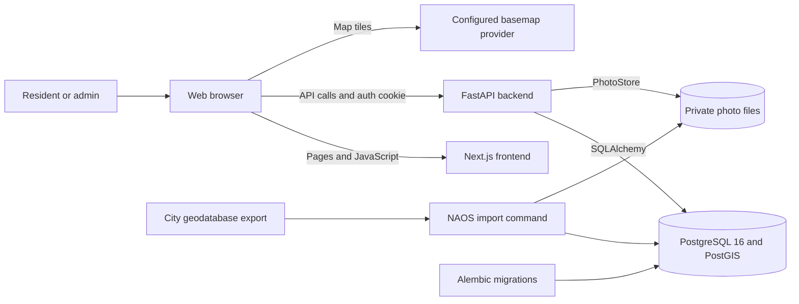
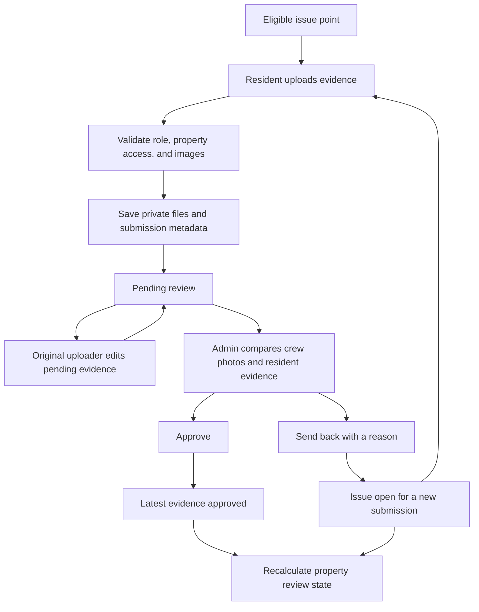

# Theory of operations

Updated November 19, 2026 · User story #48 · Task #84

## 1 Purpose and scope

The Fire Hazardous Vegetation Portal connects the City's inspection records with
resident follow-up and department review. This document explains how its parts
work together, where information is stored, and how City IT can operate the
application. Field inspections and original photo capture remain in ArcGIS and
Survey123.

The runtime described here is `dev` at `d476086`. The companion
[project scope and requirements](https://github.com/fliu-sfd/Fire_Haz_Veg_Portal/blob/9f765f1d83ea264bf6127182de07e20caf046a35/docs/requirements/project-scope.md)
is the proposed SRS in [PR #45](https://github.com/fliu-sfd/Fire_Haz_Veg_Portal/pull/45).
Its `FR`, `NFR`, and `CON` identifiers are used below. The permalink keeps that
reference readable while the requirements PR is awaiting merge.

## 2 Shared terms

Use these terms with the companion requirements. API role names are lowercase
`resident` and `admin`; the interface displays Resident and Admin.

| Term | Meaning in this portal |
| --- | --- |
| Resident | A registered homeowner or community contact who links properties and submits evidence. Registration does not verify ownership. |
| Admin | An authorized department user who manages accounts, reviews evidence, handles assessment requests, and uses the hazard map. |
| Asset ID | The City's property identifier. It groups inspection points and connects a resident account to a property. It is not an assessment UUID or a password. |
| Assessment or inspection point | One imported finding for an Asset ID and season, with its own UUID, crew result, notes, location, and photos. One property can have several points. |
| Property assessment | The latest available season's collection of inspection points for one Asset ID. |
| Crew photo | An original attachment imported from the City's inspection export. |
| Submission | A resident's completion photos and optional comment for one issue point. It has a version and a review status. |
| Pending review | Saved evidence awaiting an administrator's decision. Uploading evidence does not close the issue. |
| Send back | The interface label for a `rejected` submission. The administrator must provide a reason. |
| Property review state | The combined `open`, `pending_review`, or `closed` state derived from the latest evidence on the property's issue points. |
| Full assessment request | A separate property-level request for City follow-up, with `open` or `handled` status. It does not schedule a visit. |

## 3 Architecture



Next.js serves the pages and browser application. Browser requests go directly
to FastAPI under `/api/v1`; Next.js is not an API proxy. FastAPI routes validate
requests, enforce access rules, and call service functions. SQLAlchemy stores
application records in PostgreSQL, and PostGIS stores and queries inspection
coordinates.

Photo metadata is in PostgreSQL. Image bytes are files behind the `PhotoStore`
interface, currently implemented by `LocalDiskStore`. In Docker the `photos`
volume is mounted at `/app/photo_storage`; `pgdata` holds PostgreSQL data.
Neither volume is part of a container image. A container can be replaced while
its volumes remain, but that persistence does not replace a backup.

The browser also contacts the configured map tile provider. The default is
OpenStreetMap. City IT must select an appropriate provider and attribution for
the deployed service; the basemap is not a live connection to City inspection
data.

Code is divided into routes, services, schemas, models, importers, and storage.
See the [backend layout](../../backend/README.md#code-layout),
[frontend layout](../../frontend/README.md), and
[Compose services](../../docker-compose.yml).

## 4 Data entering the portal

### 4.1 City inspection import

The City supplies a File Geodatabase directory or `.gdb.zip` export. The import
command reads its points and photo attachments, assigns a season year, and
writes assessments and crew-photo metadata. The original City file is mounted
read-only in Docker and is kept out of Git.

Each point is identified by `(season_year, source_global_id)`. Existing points
are skipped on a repeat import. Photos are matched to a point in that season
using the attachment's parent GlobalID, then stored under generated file keys
such as `crew/<assessment UUID>/<photo UUID>.jpg`. Existing photo GlobalIDs are
also skipped. Re-importing is not a synchronization job: it does not update
changed notes or replace an existing photo's missing file.

Points commit before photo processing. If photo import fails, the points may
already be saved. Review the import counts and warnings rather than treating a
running API as proof of a complete import. The import command and source-field
mapping are described in the [database guide](../database.md).

### 4.2 Account and property linking

A resident registers with a name, email address, and password, then adds an
Asset ID after sign-in. The API normalizes the supplied ID, checks that it
exists in imported assessment data, and adds a row to `resident_assets`.
Duplicate links on the same account are refused. Resident self-service linking
permits up to 25 properties; the administrator link-management path does not
enforce that cap.

Several residents can link the same Asset ID. The current rule assumes that
someone supplying a valid ID may link it; there is no ownership-claim approval
step. All residents currently linked to an asset can read its assessment and
submission history. Removing a link revokes that resident's access while
preserving the inspection and evidence records.

Parent and prior-year Asset IDs are stored as City reference metadata. They do
not provide aliases, inherited access, or parent-child grouping. Attachment
parent GlobalIDs, which connect crew photos to inspection points, are a
different identifier.

### 4.3 Assessment display and the map

The assessment endpoint returns the newest season available for the requested
Asset ID, with all its inspection points and safe crew-photo metadata. It
returns the same unavailable response for an unknown property and one the
resident cannot access. Admins can view any asset.

The administrator hazard map instead uses the newest season in the whole
dataset. An older-only property can therefore remain available to its linked
resident without appearing on that map. Assets with located issue points can
have map markers; all issue points, including unlocated ones, contribute to the
combined review state. Results are grouped by Asset ID. Original crew
results and comments remain inspection evidence, even after corrective work
has been approved.

## 5 Resident evidence and department review



### 5.1 Upload and storage

The resident submits evidence for an assessment UUID, not directly for an Asset
ID. The point must have an original `ISSUES` result and belong to that asset's
latest season. The resident must currently be linked to the property. A point
with pending evidence uses the edit flow; a point whose latest evidence is
approved cannot receive another submission through this workflow.

A submission contains one to five JPEG or PNG files. Each file is limited to
5 MiB (`5 * 1024 * 1024` bytes) and 25 megapixels. An optional resident comment
is limited to 2,000 characters. The API checks decoded image content, declared
type, count, and size; a filename extension alone is insufficient.

Files use generated identifiers under the configured private storage root.
`submissions` records the uploader, assessment, status, timestamps, comment,
and version; `submission_photos` records the files' metadata and storage keys.
The API saves files before committing their database records and attempts
cleanup if a write fails. Disk writes and PostgreSQL are not one transaction,
which is why backups and recovery must cover both stores together.

### 5.2 Pending edits and history

Only the original uploader can edit the latest pending submission, while still
linked to an eligible issue point. New photos replace the whole saved set;
with no new photos, the existing set stays. The current edit endpoint clears
the resident comment if the multipart comment is omitted. The update changes
`updated_at` and increments the version.

An edit updates that evidence record rather than adding a history entry for
every edit. Reviewed records are read-only. After a send-back decision, the
resident can create a new submission, leaving the earlier reviewed submission
in history. Photo replacements commit before superseded files are removed.

### 5.3 Review and notifications

The administrator review inbox lists the latest pending evidence for eligible
current-season issues. The inbox and sidebar count refresh every 30 seconds.
This is the notification mechanism; there is no email or SMS delivery.

An admin opens a submission, compares its photos and comment with the original
finding and crew photos, and chooses Approve or Send back. Send back requires
a nonblank reason. The six quick-reason buttons append editable sentences to
that comment; they are frontend conveniences, not separate database reason
codes or templates configured through Settings.

The review request includes `expected_version`. The service locks and checks
the record before saving; outdated evidence, repeated decisions, superseded
submissions, and ineligible season/state changes are refused with HTTP 409.
An admin must refresh the evidence before deciding again. The saved review
contains the admin, time, decision, and comment. The homeowner can read the
decision in submission history, and the interface refreshes the related inbox,
assessment, evidence, and map data.

### 5.4 Status rules

These are three separate kinds of status:

| Record or view | Values and meaning |
| --- | --- |
| Original crew finding | `ISSUES` or `NO ISSUES`; approving resident evidence does not rewrite this value. |
| Resident submission | `pending_review`, `approved`, or `rejected`; the interface calls a rejected decision Sent back. |
| Property review state | `pending_review` if any issue's latest evidence is pending; `closed` only if every issue's latest evidence is approved; otherwise `open`. A property with no issue points has no review state. |

Uploading photos alone never clears a hazard. An issue without coordinates
still counts when deciding whether the property is closed, even though a map
marker needs located points.

The assessment detail header summarizes outstanding work differently: if one
point is pending but another still needs work, it shows Work needed. The map
and property card use the API's aggregate Pending review state in that case.

### 5.5 Full assessment requests

This is a separate workflow. From a linked property's assessment page, a
resident can request a full assessment and add an optional note of up to 2,000
characters. Only one request may be open for an Asset ID, across all residents.
If one is already open, another request returns that record without replacing
its original requester or note.

Admins list these requests in Assessment requests, filter open or handled
records, and mark an open request handled. The record keeps who handled it and
when. A later new request is allowed once the earlier one is handled. Handling
a request neither creates an inspection nor schedules an appointment, and this
queue is separate from the evidence review inbox.

## 6 Main data tables

The [database guide](../database.md#schema-overview) contains the full diagram, fields,
constraints, migrations, and sample queries. The operating relationships are:

| Table | Purpose and relationships |
| --- | --- |
| `users` | Name, email, phone, password hash, role, active flag, and sign-in/password-change timestamps. |
| `resident_profiles` | Optional address/HOA fields linked one-to-one with a user; retained in the schema but not populated by the current signup/profile flows. |
| `resident_assets` | Links a resident user to an Asset ID string. The same asset can be linked to multiple users. |
| `assessments` | Imported inspection points, grouped by Asset ID and season. Stores the original City finding and optional location. |
| `crew_photos` | Original photo metadata linked to an assessment; bytes live in the photo store. |
| `submissions` | Resident evidence linked to an assessment, with optional uploader/reviewer references, review decision, and version. |
| `submission_photos` | Metadata and storage keys for files belonging to a submission. |
| `full_assessment_requests` | Property-level follow-up requests, separate from evidence review. Stores requester, note, and handler; open/handled status is derived from `handled_at`. |
| `app_settings` | Administrator-edited portal messages, including the disabled-account message. |

`alembic_version` records the applied migration, and `spatial_ref_sys` is managed
by PostGIS. The current application migration head is `0011`.

The portal deactivates accounts rather than exposing an account-delete screen.
Database deletion of a user removes their profile and links, but retained
submissions and requests can have null user references and display Former
homeowner. Database cascades are not a general photo-file cleanup service; do
not remove assessment rows or storage files as routine account maintenance.

## 7 Access control and privacy

Both current roles sign in with local email/password accounts. Passwords are
hashed with Argon2id. The API issues a signed JWT in the HttpOnly
`fhv_access_token` cookie; the browser does not store the token in localStorage.
Default lifetimes are 60 minutes or 30 days with Remember me. Logout clears the
browser's cookie. Password changes reject tokens issued before the change's
recorded JWT second; tokens issued in that same second remain valid.

Every protected API request validates the token and reloads the user record.
Disabled or missing users are refused, and current roles determine access.
Frontend redirects and hidden menu items help navigation, but API role and
property checks enforce the permissions. Administrators cannot remove their
own access or leave the portal without an active administrator.

Crew-photo and submission-photo routes check sign-in and access to the related
property on every request. They return private, non-cacheable responses without
exposing storage keys or filesystem paths. A copied photo link is still a
protected API URL, not a public share link. A removed property link revokes
that resident's photo access.

The browser's account-data cache is kept in memory and cleared on successful
sign-out. Saved map views and column preferences do persist in localStorage;
their view names and filters should not contain sensitive resident details.
Photos and City export files stay out of Git and public frontend directories.

Microsoft sign-in for administrators is a planned production integration. It
is not activated by selecting production settings. The application currently
has no email verification, forgotten-password reset, or self-service proof of
property ownership. An existing signed-in user can change their password by
providing the current one.

## 8 Running and configuring the system

### 8.1 Configuration boundaries

The command examples use PowerShell 7.3 or later and Docker Compose v2. Use
Standard native argument passing so quoted shell/SQL strings reach the
container intact:

```powershell
$PSNativeCommandArgumentPassing = 'Standard'
```

Run Compose commands from the repository root. A root `.env` supplies Compose
substitutions. A directly started backend reads `backend/.env` when its working
directory is `backend`; the Docker image does not copy that file. A directly
started frontend uses `frontend/.env.local`.

| Setting | Where it takes effect |
| --- | --- |
| `POSTGRES_USER`, `POSTGRES_PASSWORD`, `POSTGRES_DB` | Compose database initialization and the API connection string. Defaults are for local development. Changing them on an existing `pgdata` volume does not recreate accounts, change passwords, or rename databases. |
| `POSTGRES_PORT`, `API_PORT`, `FRONTEND_PORT` | Host-published ports, defaulting to 5432, 8000, and 3000. Containers reach PostgreSQL at `db:5432`, regardless of its published host port. |
| `NAOS_DATA_DIR` | Compose's host input directory, default `./data`, mounted read-only at `/data` in the API container. |
| `AUTO_IMPORT`, `NAOS_SEASON_YEAR` | API entrypoint import switch and supplied export's season. Defaults are `true` and `2026`. Automatic import requires the literal value `true`. |
| `DATABASE_URL` | Backend database connection. Compose constructs it from the database settings; a direct backend needs the correct host address and port. |
| `PHOTO_STORAGE_DIR` | Backend private file root. Compose sets `/app/photo_storage` and mounts `photos` there; direct execution defaults to `./photo_storage`. |
| `CORS_ORIGINS` | JSON list of browser origins allowed to make credentialed API requests. Compose supplies `http://localhost:<FRONTEND_PORT>`. |
| `NEXT_PUBLIC_API_URL` | Browser-reachable API address, including `/api/v1`. Compose supplies `http://localhost:<API_PORT>/api/v1`. This is public configuration, not a place for credentials. |
| `ENVIRONMENT`, `JWT_SECRET_KEY`, `AUTH_COOKIE_SECURE` | Backend deployment settings. Production mode requires a nondefault secret of at least 32 characters and HTTPS-only cookies. |

The browser must be able to resolve its API address. Docker's service hostname
`api` is not a substitute for a browser-visible hostname. Use a consistent host
name: switching between `localhost` and `127.0.0.1` can break CORS or sign-in
cookies. Production frontend builds capture `NEXT_PUBLIC_*` values when built.

### 8.2 Start the development stack

Install Docker Desktop with Linux containers, obtain the approved City export,
and place it in `data/` or the configured host input directory. Choose the
correct season for that export. Keep an existing configuration rather than
overwriting it with example files.

```powershell
docker compose config --quiet
docker compose up --build -d
docker compose ps
docker compose logs --tail 100 api
```

Stop and inspect any failed command before continuing. On every API container
start, the entrypoint:

1. Waits for a database connection.
2. Runs `alembic upgrade head`. A migration failure stops startup.
3. If import is enabled, imports the first sorted top-level `.gdb.zip` or
   `.gdb` input from `/data`. No file means import is skipped. An import failure
   logs a warning and still allows API startup.
4. Starts Uvicorn.

The database init SQL runs only when `pgdata` is first initialized. It enables
PostGIS and pgcrypto and creates the separate `fire_hazard_veg_test` database.
That test database name is fixed in the init script, even if `POSTGRES_DB` is
customized. Migration `0006` refuses unresolved old firefighter accounts;
agree on a migration of those accounts rather than deleting or promoting them
without authorization.

With the default local ports, verify:

```powershell
Invoke-RestMethod 'http://localhost:8000/api/v1/health'
Invoke-RestMethod 'http://localhost:8000/api/v1/health/db'
docker compose exec api python -m alembic current
docker compose exec -T db sh -ec 'psql -U "$POSTGRES_USER" -d "$POSTGRES_DB" -c "SELECT season_year, count(*) FROM assessments GROUP BY season_year ORDER BY season_year;"'
```

The health endpoints check the API process and database/PostGIS respectively.
They do not verify the migration revision, expected import counts, or photo
files. Compare the import summary with the approved input, check orphaned-photo
warnings, and open both a crew photo and resident evidence through an
authorized account. Current migration head is `0011`.

Open `http://localhost:3000` and use `/api/v1` endpoints or
`http://localhost:8000/docs` for API diagnostics. The frontend can start before
the API is ready; its Compose dependency is not an API readiness check.

### 8.3 First administrator and portal settings

Residents register through the portal. Bootstrap the first local administrator
from the server command line, replacing the example identity:

```powershell
docker compose exec api python -m app.cli.create_admin --email admin@example.com --name "Portal Administrator"
```

The command prompts twice for a password and refuses an existing email. Do not
put a password in a command argument or commit credentials. Afterwards an admin
can promote an eligible existing resident from Users; linked assets must first
be removed before changing that resident to an admin.

The Settings page changes registered portal messages, currently the
disabled-account sign-in message. Defaults and limits are in
`backend/app/services/editable_messages.py`, with overrides in `app_settings`.
Settings does not manage infrastructure configuration or the quick-reason
sentences used by Send back.

For direct development outside Docker, follow the
[backend setup](../../backend/README.md#setup-with-uv) and
[frontend setup](../../frontend/README.md#run-locally). Create a backend `.env`
from `.env.example` only when it does not already exist.

### 8.4 Production deployment decisions

The checked-in Compose stack is a development environment. Its frontend runs
`npm run dev`, mounts source directories, and the database, API, and frontend
ports are published on the host. Production needs a reviewed deployment
configuration, built frontend, HTTPS ingress, appropriate network exposure,
and City-approved storage and access controls.

Compose currently forwards only its declared API environment entries. Adding
`ENVIRONMENT=production`, `JWT_SECRET_KEY`, or `AUTH_COOKIE_SECURE` to the root
`.env` alone does not pass them into the API container. City IT must explicitly
configure those values in the API process or deployment manifest, together with
the real CORS origins and browser API URL. Verify the effective environment
without logging secret values. Use nondefault database credentials and encode
reserved characters correctly when constructing a database URL; the development
Compose file concatenates its password directly into that URL.

Keep the API image, migration revision, database, and photo volume compatible
during upgrades. Take a matching backup before migrations and stop for a failed
migration rather than restarting repeatedly. Restoring the previous application
image alone does not reverse a database migration. HTTPS settings do not supply
the still-unimplemented Microsoft administrator sign-in integration.

## 9 Backup and recovery

### 9.1 What must be preserved

Back up the application database and photo volume as one set while application
writes are stopped. A database dump contains image metadata, not image bytes;
an archive of photos contains no accounts, property links, submissions,
decisions, settings, or requests. Re-importing the City file cannot rebuild
resident activity or recover files skipped because their metadata already exists.

Keep the approved source export, application release and image identifiers,
migration revision, and deployment configuration with the recovery record.
Store secrets separately in City-approved secret storage. Backups contain
private account information, comments, and photos: restrict access and copy
the verified set to approved storage outside the application host.

The following PowerShell example is for the checked-in single-host Docker
layout. The operator must first stop any manual importer, maintenance job, or
other database/photo writer. Production scheduling, retention, backup ownership,
and recovery targets must be agreed with City IT.

### 9.2 Capture a matching set

This helper stops a command sequence when Docker returns an error. It avoids
depending on PowerShell's treatment of native-command failures.

```powershell
function Invoke-PortalDocker {
    $PSNativeCommandArgumentPassing = 'Standard'
    & docker @args
    if ($LASTEXITCODE -ne 0) { throw "Docker failed; inspect the error before continuing." }
}

$backupDir = Join-Path $env:USERPROFILE ("fhv-backups\" + (Get-Date -Format 'yyyyMMdd-HHmmss'))
$backupDir = (New-Item -ItemType Directory -Path $backupDir -ErrorAction Stop).FullName
$dbId = (Invoke-PortalDocker compose ps -q db).Trim()
$apiId = (Invoke-PortalDocker compose ps -q api).Trim()
$apiImage = (Invoke-PortalDocker inspect --format '{{.Image}}' $apiId).Trim()
$mounts = Invoke-PortalDocker inspect --format '{{json .Mounts}}' $apiId | ConvertFrom-Json
$photoMount = @($mounts | Where-Object { $_.Type -eq 'volume' -and $_.Destination -eq '/app/photo_storage' })
if ($photoMount.Count -ne 1) { throw 'Expected one Docker photo volume; inspect this deployment.' }
$photoVolume = $photoMount[0].Name

Invoke-PortalDocker compose stop frontend api
Invoke-PortalDocker compose exec -T db sh -ec 'pg_dump --format=custom --no-owner --no-acl -U "$POSTGRES_USER" -d "$POSTGRES_DB" -f /tmp/portal-database.dump'
Invoke-PortalDocker cp "${dbId}:/tmp/portal-database.dump" (Join-Path $backupDir 'database.dump')
Invoke-PortalDocker run --rm --network none --entrypoint python --mount "type=volume,src=$photoVolume,dst=/photos,readonly" --mount "type=bind,src=$backupDir,dst=/backup" $apiImage -c "import tarfile; a=tarfile.open('/backup/photos.tar.gz','w:gz'); a.add('/photos',arcname='.'); a.close()"
Get-FileHash -Algorithm SHA256 (Join-Path $backupDir 'database.dump'), (Join-Path $backupDir 'photos.tar.gz') | Format-List | Out-File (Join-Path $backupDir 'checksums.txt') -Encoding utf8
```

The API container and actual photo mount are inspected before the services are
stopped. Volume names depend on the Compose project; do not assume a particular
prefix. The helper uses the existing API image's Python and bypasses its normal
entrypoint, so it does not run migrations or imports. A deployment using a bind
mount or a different photo root needs its corresponding backup procedure.

`pg_dump` writes its custom-format file inside the database container;
`docker cp` transfers the bytes. Do not replace this with a binary stdout pipe
or `>` redirection in Windows PowerShell.

While writes remain stopped, record the repository release, database and API
image IDs, migration revision, import season/counts, photo counts, and UTC
backup time beside both files. For example, the revision can be read with:

```powershell
Invoke-PortalDocker compose exec -T db sh -ec 'psql -U "$POSTGRES_USER" -d "$POSTGRES_DB" -Atc "SELECT version_num FROM alembic_version;"'
```

Check both archive files, the hashes, and the recovery record before resuming
the same installation with `Invoke-PortalDocker compose start api frontend`.
Startup runs the entrypoint again. If any backup step fails, leave writers
stopped until the failure is understood and a recovery decision is made.

### 9.3 Restore on a fresh destination

Rehearse recovery on an isolated destination before handover. These steps are
for a new, empty installation, not for overwriting the live database or merging
old and new photo trees. The Compose file has fixed container names, so an
unchanged second Compose project cannot run beside the original stack on the
same Docker host. Use a separate host or an independently reviewed override.

1. Recover the exact application release and approved configuration recorded
   with the backup. Verify the two file hashes against the recovery record.
   Use only the matching, trusted database and photo archives.
2. Set `AUTO_IMPORT=false`, build/recover the API image, and start only the
   database. Create the API container without starting it so its empty photo
   volume can be inspected. Keep the API and frontend stopped.
3. Restore the database dump before running application migrations: the dump
   already includes the schema and `alembic_version`. The `--clean` example
   below belongs only on this fresh destination; it removes objects being
   restored.
4. Restore the matching photos into the new empty photo volume. Do not overlay
   files from another installation or pair archives from different backups.
5. Check the recovered revision and counts before starting the matching API.
   Leave automatic import disabled for the initial recovery check. A later
   upgrade is a separate migration and backup decision.

Use the checked-command helper from Section 9.2. Replace `$restoreDir` with the
approved backup directory on this fresh host. The archive helper uses a patched
Python 3.11 image, version 3.11.8 or later, for safe tar extraction.

```powershell
$restoreDir = (Resolve-Path 'C:\fhv-backups\approved-backup').Path
$env:AUTO_IMPORT = 'false'
Invoke-PortalDocker compose build api
Invoke-PortalDocker compose up -d db
Invoke-PortalDocker compose create api
Invoke-PortalDocker compose run --rm --no-deps --entrypoint python api -m app.cli.wait_for_db

$dbId = (Invoke-PortalDocker compose ps -q db).Trim()
$apiId = (Invoke-PortalDocker compose ps -a -q api).Trim()
$apiImage = (Invoke-PortalDocker inspect --format '{{.Image}}' $apiId).Trim()
$mounts = Invoke-PortalDocker inspect --format '{{json .Mounts}}' $apiId | ConvertFrom-Json
$photoMount = @($mounts | Where-Object { $_.Type -eq 'volume' -and $_.Destination -eq '/app/photo_storage' })
if ($photoMount.Count -ne 1) { throw 'Expected one empty photo volume; inspect this deployment.' }
$photoVolume = $photoMount[0].Name

Invoke-PortalDocker cp (Join-Path $restoreDir 'database.dump') "${dbId}:/tmp/portal-database.dump"
Invoke-PortalDocker compose exec -T db sh -ec 'pg_restore --clean --if-exists --exit-on-error --single-transaction --no-owner --no-privileges -U "$POSTGRES_USER" -d "$POSTGRES_DB" /tmp/portal-database.dump'
Invoke-PortalDocker run --rm --network none --entrypoint python --mount "type=volume,src=$photoVolume,dst=/photos" --mount "type=bind,src=$restoreDir,dst=/backup,readonly" $apiImage -c "from pathlib import Path; import tarfile; p=Path('/photos'); assert not any(p.iterdir()), 'Restore needs an empty photo volume'; a=tarfile.open('/backup/photos.tar.gz'); a.extractall(p,filter='data'); a.close()"
```

The one-off `wait_for_db` command checks the configured database over TCP
before `pg_restore`, retrying up to 30 times. Its entrypoint is overridden, so
it runs neither migrations nor an import. Configure the API to use this
restored database and this photo volume together. Compare
table counts, season data, and revision with the backup record, then start the
API and frontend at the recovered release. Use `compose up -d api frontend`
only after those checks; rebuilding or recreating containers must retain
`AUTO_IMPORT=false` during recovery.

### 9.4 Recovery and upgrade checks

Check more than a successful process start:

- Database/PostGIS health and the expected Alembic revision.
- Account and property-link counts, submission/review history, settings, and
  open/handled assessment requests against the recovery record.
- A permitted crew photo and resident photo from the recovered file store.
  Also confirm that a signed-out or unrelated resident cannot fetch them.
- Resident and admin sign-in, one linked assessment, the review inbox, and
  request handling on synthetic data in the rehearsal environment.

Record the release, tester, date, actual results, and any corrections. Run the
[system test scripts](../testing/system-test-scripts.md) before a release
cutover; seed data belongs in a test environment, not the restored live database.
Do not claim a tested restore or handover approval from a successful dump alone.
Docker's [volume backup guidance](https://docs.docker.com/engine/storage/volumes/#back-up-restore-or-migrate-data-volumes)
and PostgreSQL's [pg_dump](https://www.postgresql.org/docs/16/app-pgdump.html)
and [pg_restore](https://www.postgresql.org/docs/16/app-pgrestore.html) references
describe the underlying tools.

## 10 Troubleshooting and known limits

| Symptom | First checks |
| --- | --- |
| Database is unavailable | Docker Desktop/Linux engine, `compose ps`, database logs, port conflicts, and the configured database name/user. Changing bootstrap variables does not alter existing database credentials. |
| API exits during startup | API logs and migration revision. Resolve a failed migration, including any legacy-role issue, before retrying. |
| API is healthy but inspections/photos are missing | Input mount, selected file and season, import counts, orphan warnings, photo metadata, and matching files. Re-import skips existing records and does not repair missing file bytes. |
| Browser requests fail or sign-in does not persist | Browser-visible API URL, matching hostname/port, CORS allowlist, and cookie HTTPS settings. A container hostname is not a browser API hostname. |
| Photo returns 404 | Current account/property link, photo metadata, and file availability. Do not make a private directory public to bypass the error. |
| Review returns 409 | Evidence was changed, reviewed, superseded, or became ineligible. Refresh before making a new decision. |

The current limits and deployment decisions are:

- **Administrator identity:** Microsoft sign-in is planned in SRS FR-03.
  Local accounts still implement current admin authentication; City IT must
  supply the integration and account-lifecycle rules.
- **Property access assumption:** A valid Asset ID is accepted without proof
  of ownership, as described in CON-03. Extra identity/claim verification is
  excluded from the current version, not silently supplied by authentication.
- **Parent and historical IDs:** Parent/prior IDs are stored but are not used
  for hierarchy lookup, inherited access, or reconciliation between seasons.
  Supporting those behaviors would need an agreed change of scope and rules.
- **Hosting and storage:** Development uses one host and private disk storage.
  Production hosting, basemap provider, approved photo storage, retention, and
  backup/recovery ownership require City IT decisions. Multiple API hosts need
  a deliberately shared store or another `PhotoStore` implementation and a
  verified file migration.
- **Follow-up boundaries:** There is no appointment scheduler, email/SMS
  delivery, live City-data synchronization, automated hazard clearance, or
  firefighter portal. A stored field or a valid signup does not imply these
  capabilities exist.
- **Guide and test coverage:** Some user-guide sections describe an earlier
  build and still mark implemented features as Planned. Use the current code,
  requirements, and test scripts to finalize them. The test plan records its
  own run date and coverage; desktop Chromium results are not a full mobile,
  accessibility, performance, or production recovery assessment.

## 11 Requirements cross references

The companion SRS snapshot linked in Section 1 uses requirement identifiers
rather than numbered sections. These references pair those identifiers with
this document's numbered operating sections without inventing SRS section
numbers.

| Companion requirement or heading | Operating explanation |
| --- | --- |
| [Users and roles](https://github.com/fliu-sfd/Fire_Haz_Veg_Portal/blob/9f765f1d83ea264bf6127182de07e20caf046a35/docs/requirements/project-scope.md#users-and-roles), FR-01 to FR-03 | [Section 2](#2-shared-terms), [Section 7](#7-access-control-and-privacy), and [Section 8.3](#83-first-administrator-and-portal-settings); current local login is distinct from planned SSO. |
| FR-02, FR-04, FR-05; CON-01 to CON-04 | [Sections 4.1 to 4.3](#4-data-entering-the-portal); import, explicit property links, and per-asset season selection. |
| FR-06 to FR-10 | [Sections 5.1 to 5.4](#5-resident-evidence-and-department-review); evidence, editing, review decisions, and derived state. |
| FR-11 to FR-13 | [Sections 4.3](#43-assessment-display-and-the-map), [7](#7-access-control-and-privacy), and [8.3](#83-first-administrator-and-portal-settings); map, user management, and supported settings. |
| FR-14 | [Section 5.5](#55-full-assessment-requests); one open request per asset, handling, and scheduling boundary. |
| NFR-01, NFR-02, NFR-04, NFR-05 | [Section 7](#7-access-control-and-privacy) and [Section 9](#9-backup-and-recovery); permissions, private files, and paired recovery. |
| NFR-03, NFR-07 | [Section 5.1](#51-upload-and-storage); actual image validation and the 5 MiB limit underlying the interface's 5 MB label. |
| NFR-06 | [Sections 5.2 to 5.3](#52-pending-edits-and-history); pending edits, feedback, quick reasons, and stale-review handling. |
| [Out of scope](https://github.com/fliu-sfd/Fire_Haz_Veg_Portal/blob/9f765f1d83ea264bf6127182de07e20caf046a35/docs/requirements/project-scope.md#out-of-scope) | [Section 10](#10-troubleshooting-and-known-limits); explicit boundaries and production decisions. |

## 12 City IT handover checks

Before accepting the deployment, the team and City IT should record:

- The chosen release and matching image identifiers, migration revision,
  approved dataset/season, and deployment configuration.
- The service owner, host, HTTPS/DNS and network configuration, database
  account responsibilities, and the browser API/CORS configuration.
- The initial administrator process and the decision/implementation status
  of Microsoft sign-in.
- Photo storage location, permissions, capacity, retention/deletion policy,
  and how database and photo backups are protected off-host.
- Backup frequency, recovery objectives, restore owner, and a completed
  recovery rehearsal with authorized photo reads.
- A walkthrough by someone who did not write the operating instructions,
  covering startup, login, property access, upload/review, assessment requests,
  troubleshooting, and recovery.
- Updated user guides and the recorded release-test results, with the
  remaining limits and responsibility for follow-up work.

Use the [database guide](../database.md),
[backend instructions](../../backend/README.md),
[photo storage decision](../decisions/0001-photo-storage.md), and
[test plan](../testing/test-plan.md) alongside these checks. Handover is complete
when the receiving team has recorded successful operation and recovery of the
agreed deployment.
