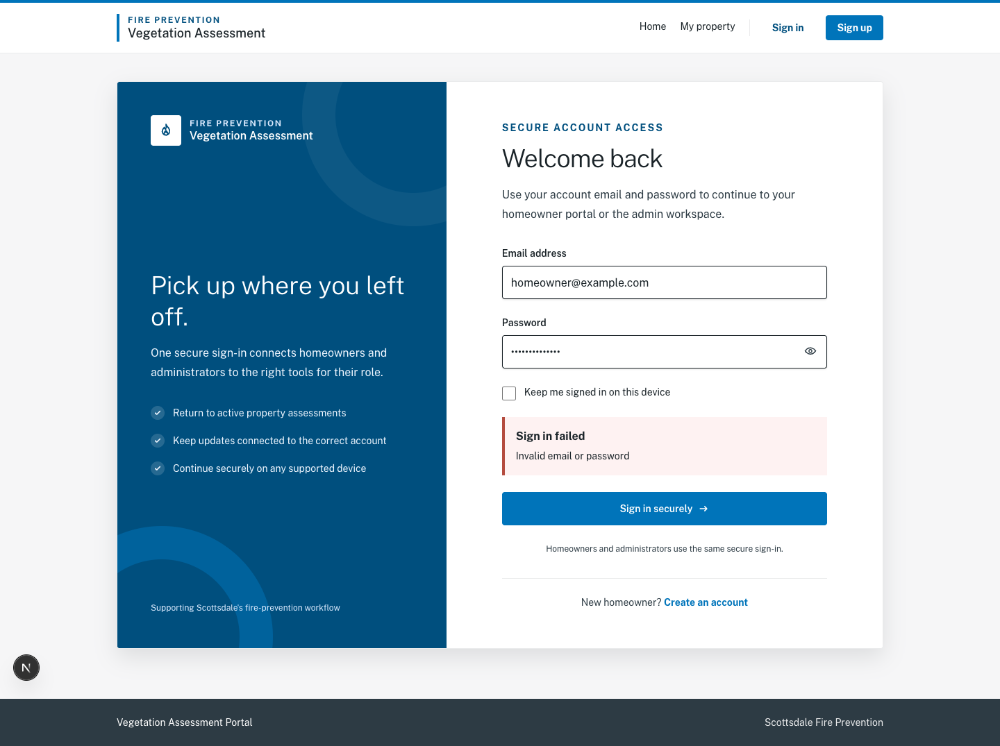
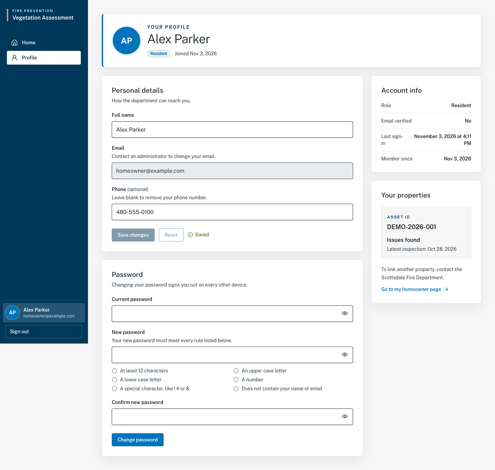
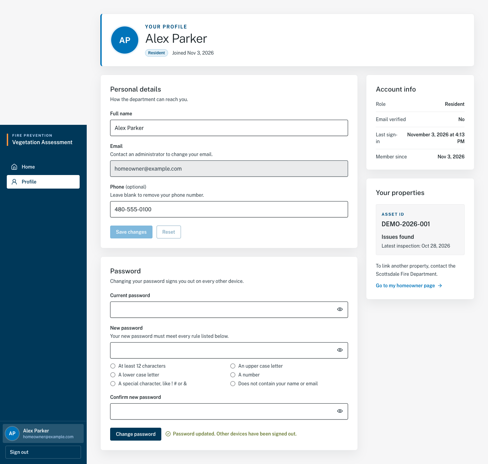
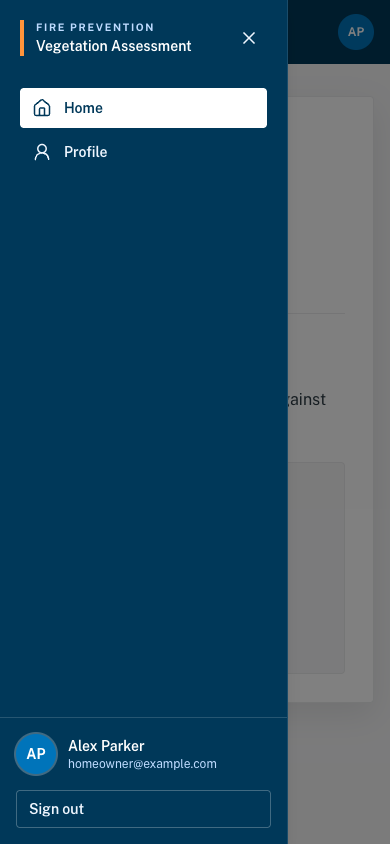

# Shared account instructions

Validated against the November 3, 2026 build (`208bfcd`). Planned workflows remain unavailable.

These instructions apply to homeowners and administrators.
Return to your [role guide](README.md) for the actions specific to your account.

## C01 — Sign in

Before you start: you need an active account and its email and password.

1. Open the portal and select **Sign in**, or open `/sign-in`.
2. Enter **Email address** and **Password**.
3. If using your own device, you may select **Keep me signed in on this device**.
4. Select **Sign in securely** and wait for the page to finish loading.

Expected result: a homeowner reaches **Connected properties** on `/homeowner`.
An administrator reaches **Department portal** on `/dashboard`.

| Message | What to do |
| --- | --- |
| “Invalid email or password” under “Sign in failed” | Check both fields and try again. |
| A box titled “Account disabled”, usually with “Account is disabled. Contact the Scottsdale Fire Department.” An administrator can change this wording. | Follow the message, or contact the department about account access. You only see this after entering the correct password. |
| “We could not reach the service. Check your connection and try again.” | Check your connection, then retry. |

## C02 — View and update your profile

1. Sign in and select **Profile** in navigation, or select your name/avatar. On a phone, you can also select the profile avatar in the top bar.
2. Review **Account info**, including your role, email verification indicator, last sign-in and member-since date.
3. In **Personal details**, edit **Full name** and, optionally, **Phone**. Clear Phone to remove it.
4. Select **Save changes**. To discard edits before saving, select **Reset**.

Expected result: **Saved** appears after a successful save. Before saving, changed
fields produce **You have unsaved changes**. Email is read-only on your own
profile; contact the department if it needs correction. A homeowner also sees
**Your properties** and can select **Add or remove properties** to open the homeowner page.

| Message | What to do |
| --- | --- |
| “Enter a full name.” | Enter your name before saving. |
| “Use only letters, spaces, apostrophes, hyphens, and periods.” | Correct unsupported characters in the name. |
| “Phone must have 10 to 15 digits.” | Correct the number, including any country code, or leave it blank. |
| “Your session has ended. Sign in again to continue.” | Sign in again, then check whether the change was saved. |
| “The server could not save the change. Try again in a moment.” | Wait and retry; confirm “Saved” before leaving. |

Names must contain 2–120 characters. Phone is optional, allows a leading `+`,
spaces, hyphens and parentheses, and has a 20-character maximum.

## C03 — Change your password

1. Open **Profile** and find **Password**.
2. Enter **Current password**.
3. Enter **New password** and satisfy the on-screen checklist: at least 12 characters, upper- and lowercase letters, a number and a special character. Do not include your name or email.
4. Enter the same value in **Confirm new password**. Use a different password from your current one, no more than 128 characters, without leading or trailing spaces.
5. Select **Change password**.

Expected result: **Password updated. Other devices have been signed out.**
Your current session continues; use the new password for your next sign-in.

| Message | What to do |
| --- | --- |
| “Your current password is not correct.” | All three password fields are cleared. Re-enter your current password, new password and confirmation, then submit again. |
| “Passwords do not match.” | Make the new-password entries identical. |
| “Choose a password that is different from your current one.” | Choose another password. |
| “Password must not contain your name or email.” | Remove personal information from the password. |
| “Password must be at least 12 characters.” | Lengthen the new password and satisfy all checklist rules. |

## C04 — Sign out

1. Save any changes you intend to keep.
2. Select **Sign out** below your account details in the sidebar. On a phone, open navigation first.
3. Wait while **Signing out…** appears.

Expected result: you return to `/sign-in`. If an error appears under the action,
retry and confirm the sign-in page appears before leaving a shared device.

