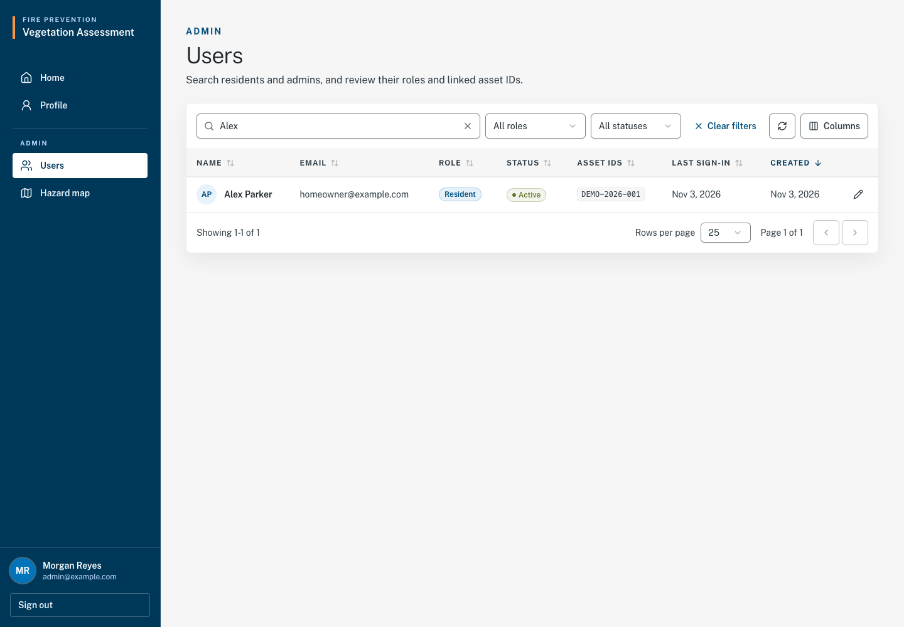
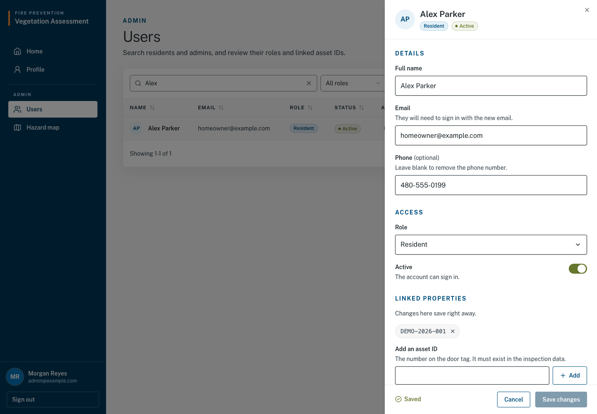
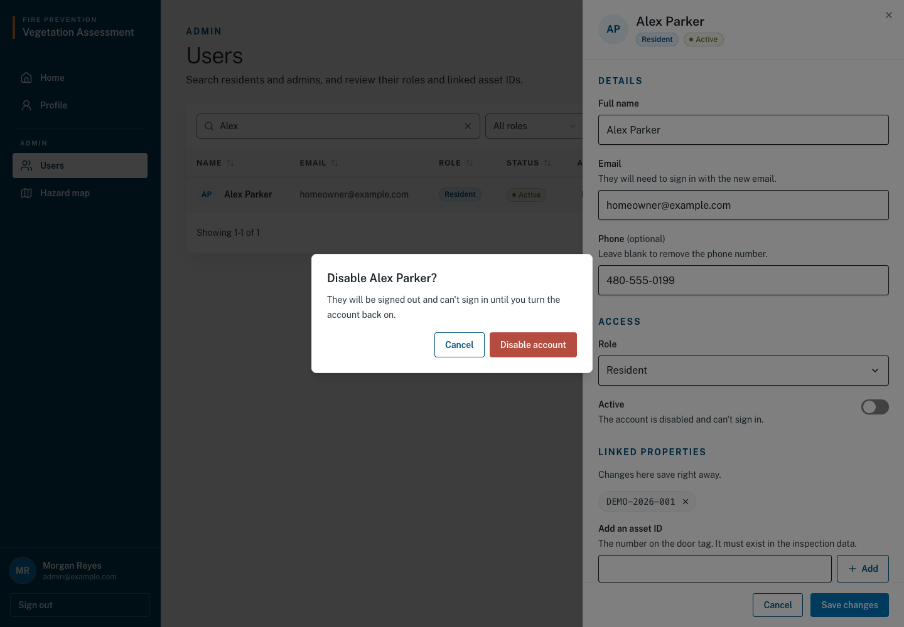
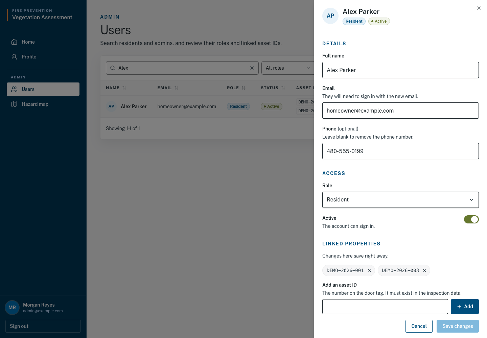
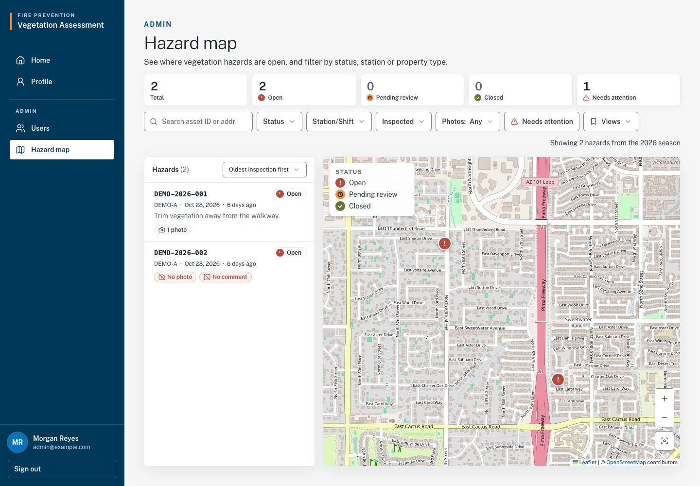
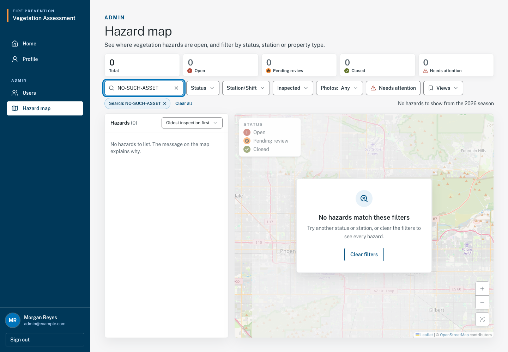
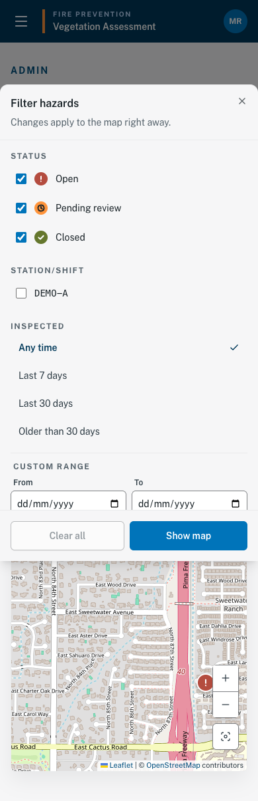
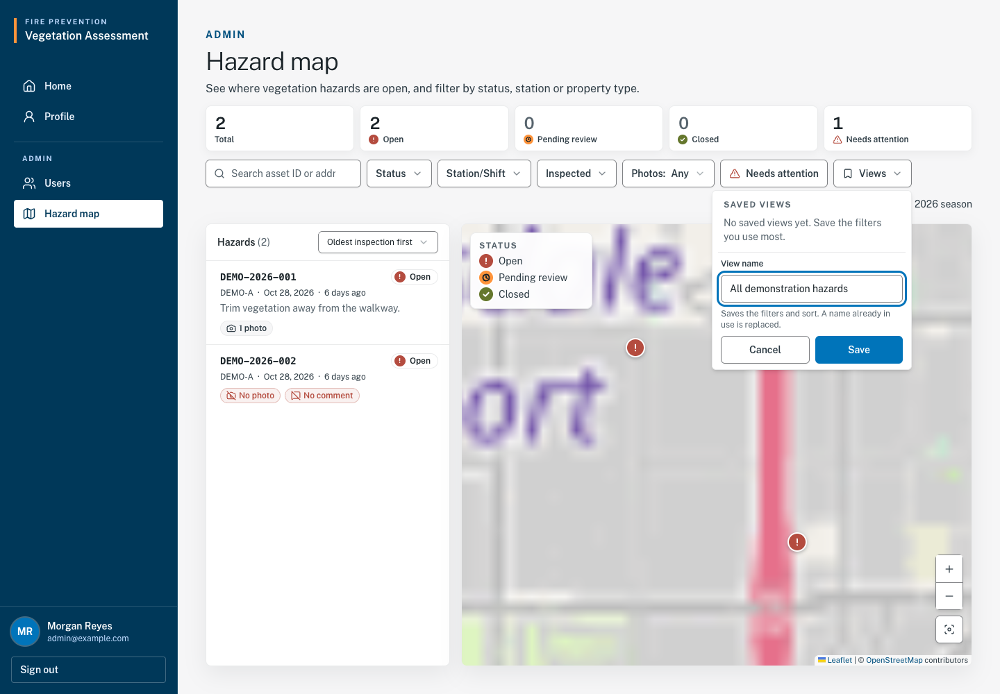
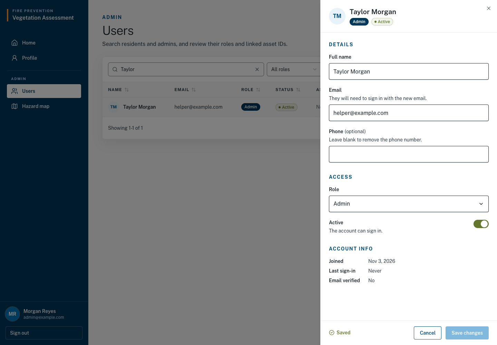

# Administrator user guide

Updated November 3, 2026 · Story #51 · Draft #75 / screenshots and validation #76

This is the separate guide for an **Admin** account. Sign in using
[C01](account.md#c01--sign-in). You need an existing active administrator account
(see [A07](#a07--create-an-administrator-account--available));
homeowner self-registration does not grant administrator access. After signing
in, open **Users**, **Hazard map** or **Settings** under **Admin** in navigation.

## A01 — Find an account — Available

1. Select **Users** to open `/dashboard/users`.
2. Use **Search by name, email, or asset ID** to locate an account.
3. Narrow the list with the role selector (**All roles**, **Resident**, **Admin**) and status selector (**All statuses**, **Active**, **Disabled**).
4. Use table headings to sort and pagination to move through results. Use the column menu if you need additional account details.
5. Select the user's name or pencil action to open the edit panel.

Expected result: the matching account's details load in a side panel. If filters
hide an expected user, clear them and search again. **Administrator access
required.** means the account lacks access. **Your session has ended. Sign in
again to continue.** means you need to sign in again.

## A02 — Edit an account — Available

1. Open the account through A01 and confirm the selected name and email.
2. Update **Full name**, **Email** or **Phone** as needed. A changed email becomes the user's sign-in email; tell them the new value through your normal department process.
3. Change **Role** only when authorized. Remove a homeowner's linked properties (A04) before making them an administrator.
4. Select **Save changes**. Confirm a role change when prompted with **Change role**.
5. Check for **Saved**. Select **Cancel** to close without saving pending details; if prompted, choose whether to discard them or keep editing.

Expected result: saved details appear in the panel and refreshed list. Role
changes affect access on the user's next request. Your own role and active
status are protected, and the last active administrator cannot be removed by
a role/status change. The current code supports email and role editing beyond
the original sprint proposal; this guide describes the current screen.

| Message | What to do |
| --- | --- |
| “Another account already uses this email.” | Use the correct, unique email. |
| “Remove this user's linked properties before changing their role.” | Check the intended access change before following A04. |
| “You can't change your own role or turn off your own account.” | Have another authorized administrator manage access if needed. |
| “This is the only active admin. Make another user an admin before changing this account.” | Preserve an active administrator before retrying. |

## A03 — Deactivate or reactivate an account — Available

1. Find and open the account through A01. Verify you have selected the intended person.
2. Turn off the **Active** switch under **Access**.
3. Select **Save changes**, then confirm **Disable account** in the **Disable <name>?** dialog. If you also changed role, the action is **Disable and change role**.
4. Check for **Saved** and the account's disabled status.
5. To reactivate, find the account using **Disabled** or **All statuses**, turn **Active** on and select **Save changes**.

Expected result: a disabled account cannot sign in and an existing session is
refused on its next request. If that person then signs in with the correct password,
they see the message set under [A10](#a10-edit-portal-messages-available).
Reactivation restores sign-in eligibility. You
cannot disable yourself or the last active administrator; use the error table
in A02 to resolve those cases. Disabling does not delete the account.

## A04 — Correct a homeowner's linked properties — Available

1. Open the Resident account and find **Linked properties**.
2. To add a property, enter its Asset ID in **Add an asset ID** and select **Add**.
3. To remove a link, select its remove action and confirm **Remove property**.
4. Verify the linked-ID list after each operation.

Expected result: property-link changes **save right away**, separately from
**Save changes** for account details. Closing or cancelling the edit panel does
not undo them. Removing a link means the homeowner no longer sees that property.
Only homeowner accounts can have linked properties.

If **No inspection record has this asset ID. Check it and try again.** appears,
check the door tag and imported records. If **The property change was not saved**
appears, read the accompanying error and check the list before retrying.

## A05 — Use the hazard map, filters and counts — Available with status limitation

1. Select **Hazard map** to open `/dashboard/hazards`.
2. Read the reported season and **Total**, **Open**, **Pending review**, **Closed** and **Needs attention** tiles.
3. Enter an Asset ID or address in **Search asset ID or address**. Narrow results with **Status**, **Station/Shift**, **Inspected**, **Photos**, property type or **Needs attention**.
4. Under **Inspected**, choose a preset or enter **From** and **To**, then select **Apply range**. Reporting dates use Scottsdale/Phoenix time. Older 2026 inspections may not appear under recent-day presets.
5. Select a list item or map pin to see its details. On a narrow screen, switch between **Map** and **List**; use **Filters** to open the filter panel and **Show map** to close it.
6. Select a filter chip to remove it, or **Clear all** to reset filters. Selecting a state tile narrows to that state; selecting it again restores all states.

Expected result: the map/list update to match your filters. One hazard row/pin
represents an **Asset ID with located ISSUES points**, not every inspection
point or every property. The pin summarizes those issue locations and may not
be the exact location of each finding. No-issue-only properties are not hazards.

| Count | Meaning in the reviewed build |
| --- | --- |
| Total | Hazard assets matching all current filters; not a count of all inspection points. |
| Open / Pending review / Closed | Counts matching the other filters while ignoring the selected state filter. An asset is Pending review when any current issue's latest submission is pending, Closed when all issues have approved evidence, and Open otherwise. |
| Needs attention | Hazard assets missing a photo or comment in the map's summarized record. This count follows other filters but ignores the Needs attention toggle. It is a record-quality indicator, not a separate review state. |

Do not treat a pending submission as an approved resolution. Pending review means
evidence is waiting for department verification. Closed requires an administrator decision.

The map currently labels non-NAOS records Residential; classification is
provisional, so confirm property type before relying on it for decisions.

| Message | What to do |
| --- | --- |
| “No hazards match these filters” | Select Clear filters or adjust your selection. |
| “No hazards recorded” | Ask the data administrator whether inspection data has been imported. |
| “Only the first results are on the map. Narrow the filters to see the rest.” | Narrow the filters; do not assume every result is displayed. |
| “We could not load hazards” | Read the error and select Retry. |
| “Administrator access required” | Sign in with the correct role or contact the department administrator. |

## A06 — Save a filter view — Available

1. Set the filters and list sort you want to reuse.
2. Open **Views** and select **Save current view**.
3. Enter a name and select **Save**. A name already in use is replaced.
4. Reopen Views and choose the saved entry to apply its filters and sort.

Expected result: the view is saved in this browser. It is not
a department-wide saved view and does not synchronize across devices. Use the
entry's delete action to remove an unwanted view. Follow any name/limit message
shown before saving.

## A07 — Create an administrator account — Available

There is no account-creation form in the portal. An administrator comes from one
of two places:

1. For an existing homeowner account, find it using A01 and remove its linked properties using A04.
2. In its edit panel, change **Role** to **Admin**, select **Save changes**, then confirm **Change role**.
3. Confirm the **Admin** badge appears, then have the user sign in again.

If no administrator exists yet, ask the developer with server access to follow
[Create the first admin](../../backend/README.md#create-the-first-admin).
The command line is the bootstrap path; there is no public administrator signup.

Expected result: the account appears in **Users** with the **Admin** role and can
sign in using [C01](account.md#c01--sign-in). When creating an account through the
command line, an email already in use is refused and nothing changes. Promotion
keeps the existing account. Homeowners continue to self-register with Asset IDs.

sign in using [C01](account.md#c01--sign-in). An email already in use is refused and
nothing changes. Homeowners continue to self-register and add their own Asset IDs.

The command-line bootstrap has no portal screen.

## A08 — Review homeowner fix submissions — Available

1. Sign in as an administrator and open **Review inbox**. Its sidebar badge shows waiting submissions; the page lists who submitted, property, time, and photo count. It refreshes every 30 seconds; **Refresh** checks immediately.
2. Select **Review submission** on the notification and verify the property and inspection point. You can also use **Hazard map → select property → View assessment & submissions**.
3. Compare the original finding and crew photos with the homeowner's photos and comment. Enlarge photos as needed.
4. Read **Submission history**, the homeowner's comment, and any updated timestamp. **View photo** previews an image; the thumbnail opens the protected image in a new tab. Admins cannot edit the homeowner's evidence.
5. Under **Review this submission**, select **Approve — completed work verified** or **Send back — more work or evidence needed**. Enter a **Department comment** (required for Send back; optional for Approve).
6. Select **Save decision**. The decision, comment, and review time appear in history for both the department and homeowner. The reviewed record cannot be edited or decided again.
7. Return to **Review inbox**; the item is no longer waiting. Sending back lets the homeowner submit new evidence. Map counts update; a property closes only when all issue points are approved.

Expected result: approval moves that issue to Closed; sending it
back returns it to Open with the reason visible to the homeowner. The decision
records who acted and when. The original inspection result stays unchanged.
A second decision on the same submission must be refused; refresh if another
administrator has already reviewed it.

If the homeowner changed the evidence or another administrator already decided,
the server refuses the decision. Refresh the assessment, compare the latest evidence,
and decide only if it is still pending. No email or text alert is included.

Screenshot A08: placeholder for queue/count, side-by-side photos, approve result and required send-back reason.

## A09 — Handle full-assessment requests — Planned (#45)

1. After release, open the planned **Requests** page under Admin.
2. Review open requests first, checking Asset ID, homeowner, request date, note and status. Use the planned Open/Handled filter when needed.
3. Follow the department's agreed process outside the portal to address the request.
4. Select the planned **Mark handled** action only when appropriate, and check the updated status.

Expected result after release: the request records when and by whom it was
handled and no longer blocks a new homeowner request. This is a request log,
not visit scheduling. Which staff receive requests and how visits are arranged
remain unconfirmed; do not infer a scheduled appointment from a portal status.
Final action labels, errors and confirmation wording await the released screen.

Screenshot A09: placeholder for Open/Handled lists and a handled request.

## A10: Edit portal messages (Available)

Settings lists the messages you can reword without a developer. Each message has its own card and saves on its own.

1. Open **Settings** under **Admin**.
2. Edit the text in **Message**. The card shows the allowed length and number of lines, and **Preview** shows what the person will see. Messages are plain text, so links and bold are not available.
3. Select **Save message** and check for **Saved**. The line under the buttons shows who last changed the message and when.
4. To go back to the original wording, select **Reset to default**, then confirm **Reset to default** in the **Reset this message to the default?** dialog. The saved text is not kept.

Expected result: the new text is used the next time the message is shown. For the **Disabled account message**, that is the next time a disabled person signs in with the correct password. Someone disabled while already signed in is sent to the sign-in page and sees this message only if they sign in again.

Screenshot A10: pending Settings card with preview.

## Maintain your own profile and finish

1. Use [C02](account.md#c02--view-and-update-your-profile) to update your own name or phone.
2. Use [C03](account.md#c03--change-your-password) to change your password.
3. Use [C04](account.md#c04--sign-out) to sign out when finished.

Expected result: your own account updates follow the same confirmations as
other roles. Screenshots C02–C04 cover these shared procedures. See the
[portal limitations](README.md#what-the-portal-does-not-do) for sprint boundaries.
